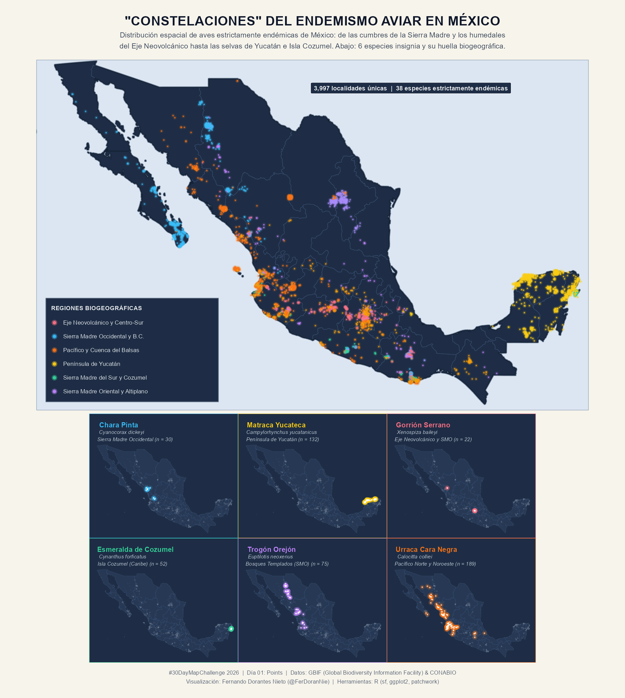
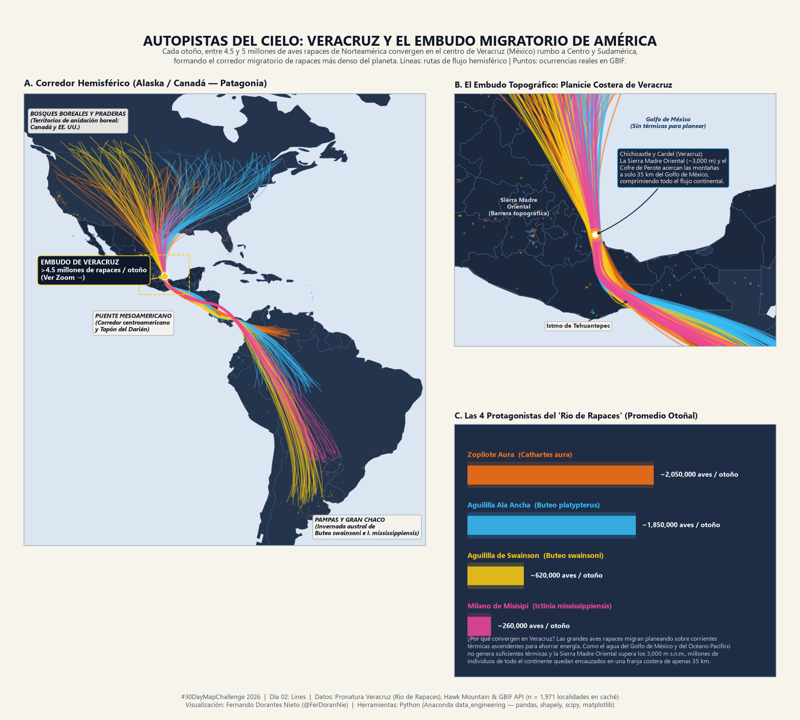
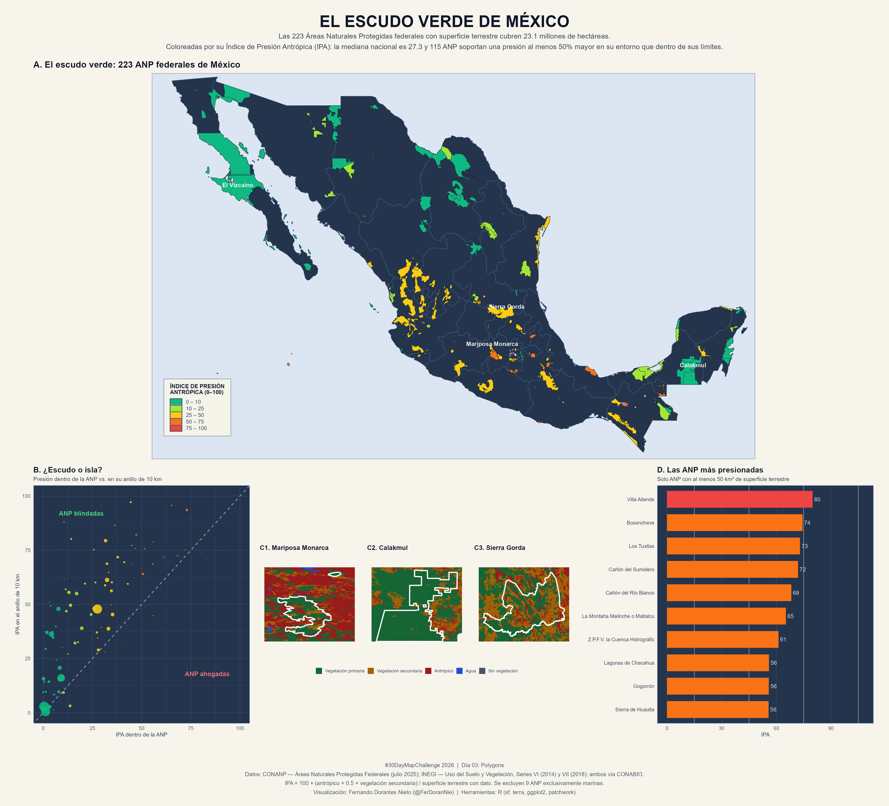
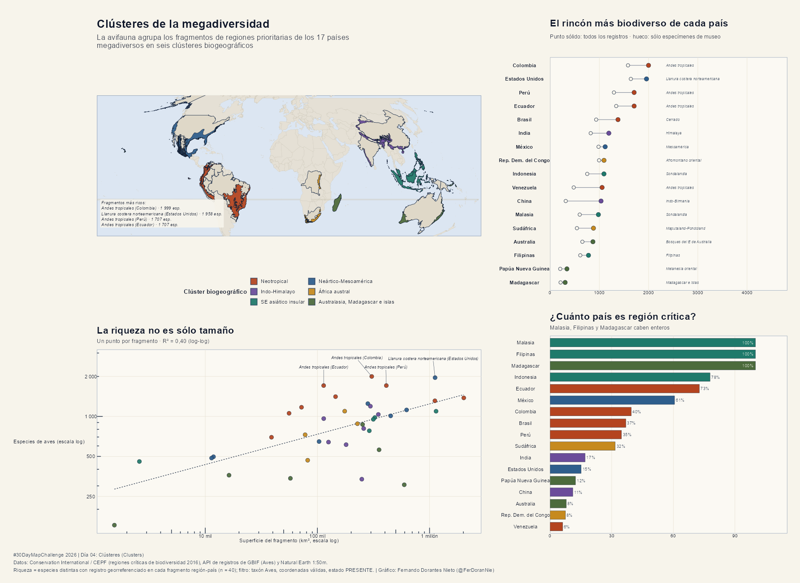
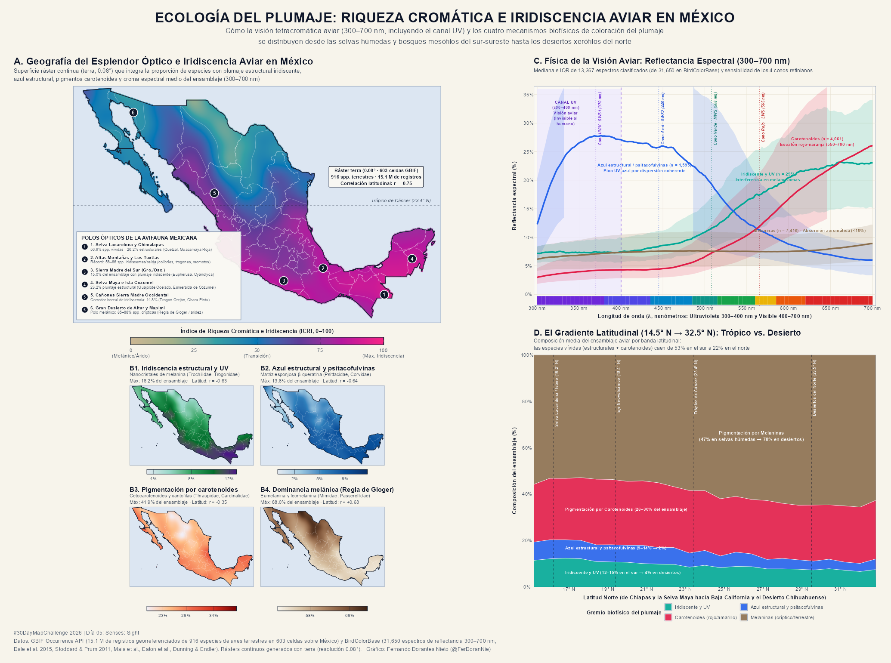

# 🗂️ Guía de Commits Progresivos — #30DayMapChallenge 2026

Esta guía contiene la secuencia ordenada de comandos `git` y mensajes de commit para publicar tu repositorio de forma progresiva:
1. **Commit 0 (Base del repositorio):** Sube toda la infraestructura, plantillas (`utils/`), reglas (`AGENTS.md`), `.gitignore` y las carpetas de los 30 días, **excluyendo** los scripts y mapas ya terminados para que puedas ir liberándolos día por día.
2. **Commits Día 01 al Día 30:** Comandos exactos para subir cada día (código + README del día + miniatura en `outputs/gallery/` + actualización del `README.md` principal).

---

## 🚀 Paso 0: Commit Inicial (Estructura Base sin revelar los mapas aún)

Si quieres hacer tu primer `push` hoy subiendo **únicamente la estructura base del proyecto** (sin incluir todavía los scripts `.R`/`.py` ni las imágenes de `outputs/gallery/` de los días que ya adelantamos):

```powershell
# 1. Agregar README.md (solo texto, sin imágenes aún), configuración, utilidades y estructura base
git add README.md .gitignore AGENTS.md COMMITS_GUIDE.md utils/ data/raw/.gitkeep data/processed/.gitkeep outputs/gallery/.gitkeep outputs/high_res/.gitkeep

# 2. Agregar las carpetas de los días que aún solo tienen su README.md base
git add days/day06_* days/day07_* days/day08_* days/day09_* days/day10_* days/day11_* days/day12_* days/day13_* days/day14_* days/day15_* days/day16_* days/day17_* days/day18_* days/day19_* days/day20_* days/day21_* days/day22_* days/day23_* days/day24_* days/day25_* days/day26_* days/day27_* days/day28_* days/day29_* days/day30_*

# 3. Crear el commit inicial de arquitectura
git commit -m ":bird: :parrot: Iniciando el repositorio Repo30DayMapChallenge2026, estructura, temas y calendario"

# 4. Conectar con tu repositorio remoto en GitHub y subir
# git branch -M main
# git remote add origin https://github.com/FerDoranNie/Repo30DayMapChallenge2026.git
# git push -u origin main
```

---

## 🖼️ Bloques de Imágenes para ir agregando día a día en `README.md`

Cuando vayas a publicar cada día, cambia su estado de `⏳ Pendiente` a `✅ Completado` en la tabla de `README.md` y pega su bloque debajo de `## 🖼️ Galería de Mapas`:

```markdown
### Día 01 — Points: Constelaciones del Endemismo Alado en México
[](./days/day01_points/day01_aves_endemicas.R)

### Día 02 — Lines: Autopistas del Cielo (Veracruz y el Embudo Migratorio de América)
[](./days/day02_lines/day02_rutas_rapaces.py)

### Día 03 — Polygons: El Escudo Verde de México (ANP y presión antrópica)
[](./days/day03_polygons/day03_anp_presion.R)

### Día 04 — Clusters: Clústeres de la Megadiversidad
[](./days/day04_clusters/)

### Día 05 — Senses: Sight: Ecología del Plumaje e Iridiscencia Aviar en México
[](./days/day05_senses_sight/)
```

---

## 📅 Commits Diarios (Día 01 al Día 30)

Conforme vayas publicando cada día del reto, ejecuta el bloque correspondiente:

### Día 01 — Points (01 de noviembre)
```powershell
git add days/day01_points/ outputs/gallery/day01_points_aves_endemicas.png README.md
git commit -m "Añadiendo Día 1 Mapa de puntos - Constelación de endemismos aviares en México"
git push
```

### Día 02 — Lines (02 de noviembre)
```powershell
git add days/day02_lines/ outputs/gallery/day02_lines_veracruz_rio_rapaces.png README.md
git commit -m "Añadiendo Día 2 Mapa de lineas - Veracruz Río de Rapaces"
git push
```

### Día 03 — Polygons (03 de noviembre)
```powershell
git add days/day03_polygons/ outputs/gallery/day03_polygons_anp_presion.png README.md
git commit -m "Añadiendo Día 3 Estado actual de las áreas protegidas de México"
git push
```

### Día 04 — Clusters (04 de noviembre)
```powershell
git add days/day04_clusters/ outputs/gallery/day04_clusters_megadiversidad.png README.md
git commit -m "Añadiendo Día 4 ¿Dónde se concentra la diversidad en los países megadiversos?"
git push
```

### Día 05 — Senses: Sight (05 de noviembre)
```powershell
git add days/day05_senses_sight/ outputs/gallery/day05_senses_sight_plumaje.png README.md
git commit -m "Añadiendo Día 5 ¿Se puede mapear la iridiscencia de las aves?"
git push
```

### Día 06 — Vintage (06 de noviembre)
```powershell
git add days/day06_vintage/ outputs/gallery/day06_vintage_historical_species.png README.md
git commit -m "feat(day06): add Day 06 Vintage map - Historical vs current species distribution"
git push
```

### Día 07 — 10 minute map (07 de noviembre)
```powershell
git add days/day07_10_minute_map/ outputs/gallery/day07_10min_mapa_relampago.png README.md
git commit -m "feat(day07): add Day 07 10-minute map - Rapid spatial visualization of Mexico"
git push
```

---

## 📋 Plantilla Estándar para los Días 08 al 30

Para mantener un historial de Git limpio bajo la convención **Conventional Commits** (`feat(dayXX): ...`), usa esta tabla de mensajes listos para copiar y pegar:

| Día | Comando `git add` | Mensaje de `git commit -m "..."` |
| :---: | :--- | :--- |
| **08** | `git add days/day08_utopia/ outputs/gallery/day08* README.md` | `"feat(day08): add Day 08 Utopia map - 30x30 biological corridors and restoration"` |
| **09** | `git add days/day09_urban_rural/ outputs/gallery/day09* README.md` | `"feat(day09): add Day 09 Urban-rural map - Metropolitan expansion in Mexico"` |
| **10** | `git add days/day10_prompting_only/ outputs/gallery/day10* README.md` | `"feat(day10): add Day 10 Prompting only map - Fauna and flora toponyms in Mexico"` |
| **11** | `git add days/day11_senses_sound/ outputs/gallery/day11* README.md` | `"feat(day11): add Day 11 Senses: Sound map - Dawn chorus and bird acoustics"` |
| **12** | `git add days/day12_power/ outputs/gallery/day12* README.md` | `"feat(day12): add Day 12 Power map - Socioeconomic cardinal orientation in Mexican cities"` |
| **13** | `git add days/day13_interactions/ outputs/gallery/day13* README.md` | `"feat(day13): add Day 13 Interactions map - Biotic interaction and wildlife networks"` |
| **14** | `git add days/day14_borgesian_map/ outputs/gallery/day14* README.md` | `"feat(day14): add Day 14 Borgesian map - Calligraphic map of endemic species"` |
| **15** | `git add days/day15_inside_out/ outputs/gallery/day15* README.md` | `"feat(day15): add Day 15 Inside out map - Inverted topography of the Valley of Mexico"` |
| **16** | `git add days/day16_collaborative_map/ outputs/gallery/day16* README.md` | `"feat(day16): add Day 16 Collaborative map - Citizen science observations in Mexico"` |
| **17** | `git add days/day17_light_and_dark/ outputs/gallery/day17* README.md` | `"feat(day17): add Day 17 Light & dark map - Nighttime light pollution vs bird migration"` |
| **18** | `git add days/day18_null/ outputs/gallery/day18* README.md` | `"feat(day18): add Day 18 NULL map - Biological Terra Incognita and sampling gaps"` |
| **19** | `git add days/day19_senses_smell/ outputs/gallery/day19* README.md` | `"feat(day19): add Day 19 Senses: Smell map - Urban olfactory landscape in Mexico"` |
| **20** | `git add days/day20_hexagons/ outputs/gallery/day20* README.md` | `"feat(day20): add Day 20 Hexagons map - H3 biodiversity and deforestation mosaic"` |
| **21** | `git add days/day21_openstreetmap/ outputs/gallery/day21* README.md` | `"feat(day21): add Day 21 OpenStreetMap map - Urban green space accessibility"` |
| **22** | `git add days/day22_projections/ outputs/gallery/day22* README.md` | `"feat(day22): add Day 22 Projections map - Arctic Tern pole-to-pole migration"` |
| **23** | `git add days/day23_senses_taste/ outputs/gallery/day23* README.md` | `"feat(day23): add Day 23 Senses: Taste map - Vavilov center and native crops in Mexico"` |
| **24** | `git add days/day24_network/ outputs/gallery/day24* README.md` | `"feat(day24): add Day 24 Network map - River basins and fluvial connectivity"` |
| **25** | `git add days/day25_is_this_a_map/ outputs/gallery/day25* README.md` | `"feat(day25): add Day 25 Is this a map? - Spatial ridgelines and spectrograms"` |
| **26** | `git add days/day26_water/ outputs/gallery/day26* README.md` | `"feat(day26): add Day 26 Water map - Aquifer overexploitation and water stress in Mexico"` |
| **27** | `git add days/day27_new_tool/ outputs/gallery/day27* README.md` | `"feat(day27): add Day 27 New tool map - Massive biodiversity rendering"` |
| **28** | `git add days/day28_senses_feeling/ outputs/gallery/day28* README.md` | `"feat(day28): add Day 28 Senses: Feeling map - Urban heat islands and thermal vulnerability"` |
| **29** | `git add days/day29_raster/ outputs/gallery/day29* README.md` | `"feat(day29): add Day 29 Raster map - Canopy height and shaded relief in cloud forests"` |
| **30** | `git add days/day30_pen_and_paper/ outputs/gallery/day30* README.md` | `"feat(day30): add Day 30 Pen & paper map - Naturalist field notebook birding route"` |
