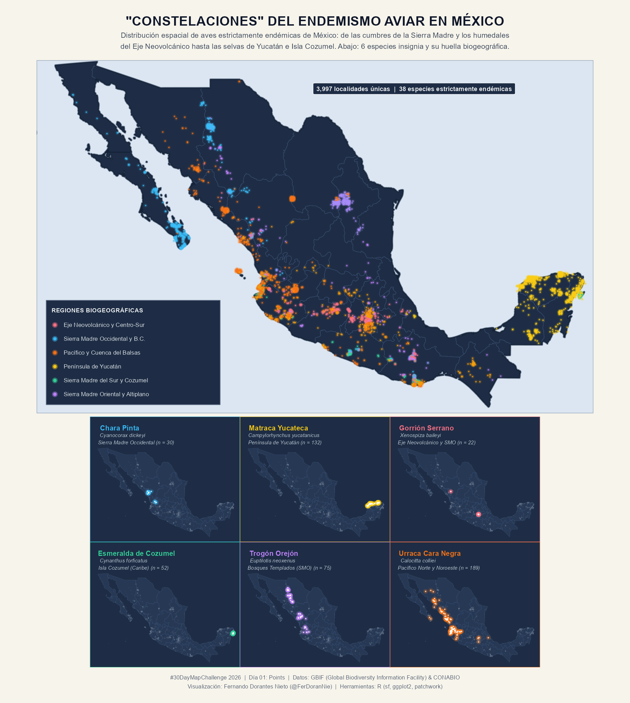
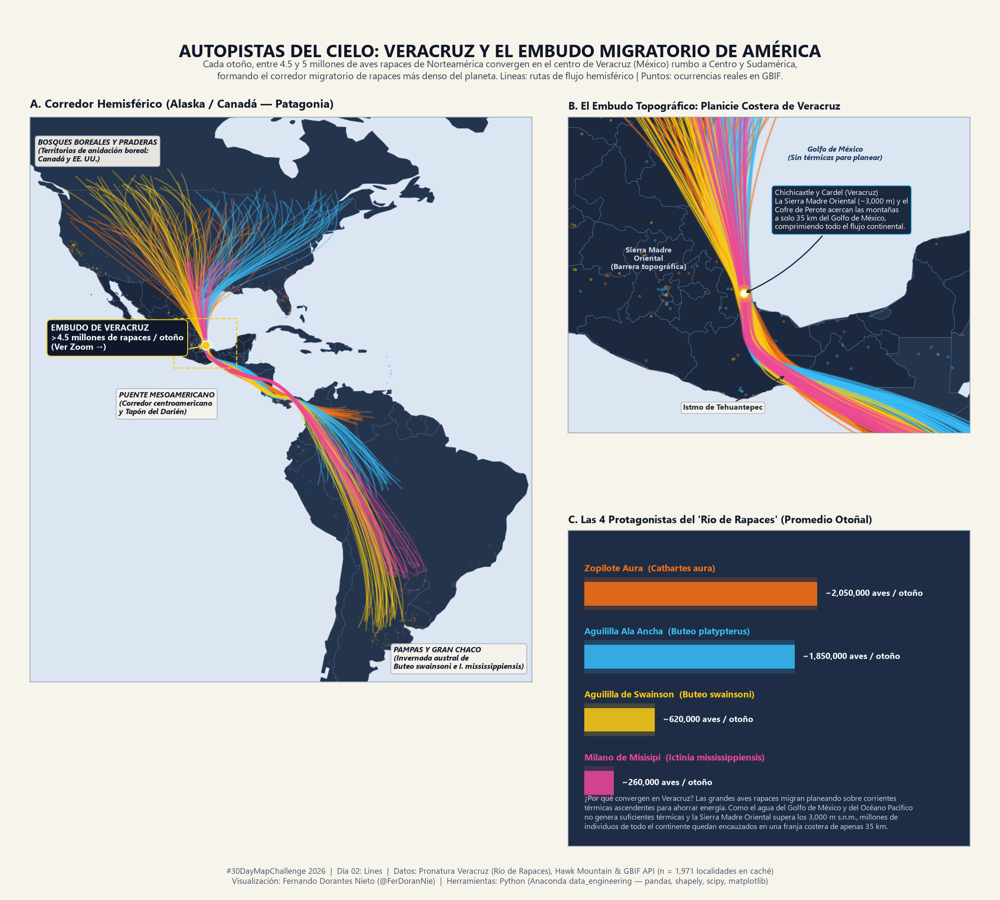
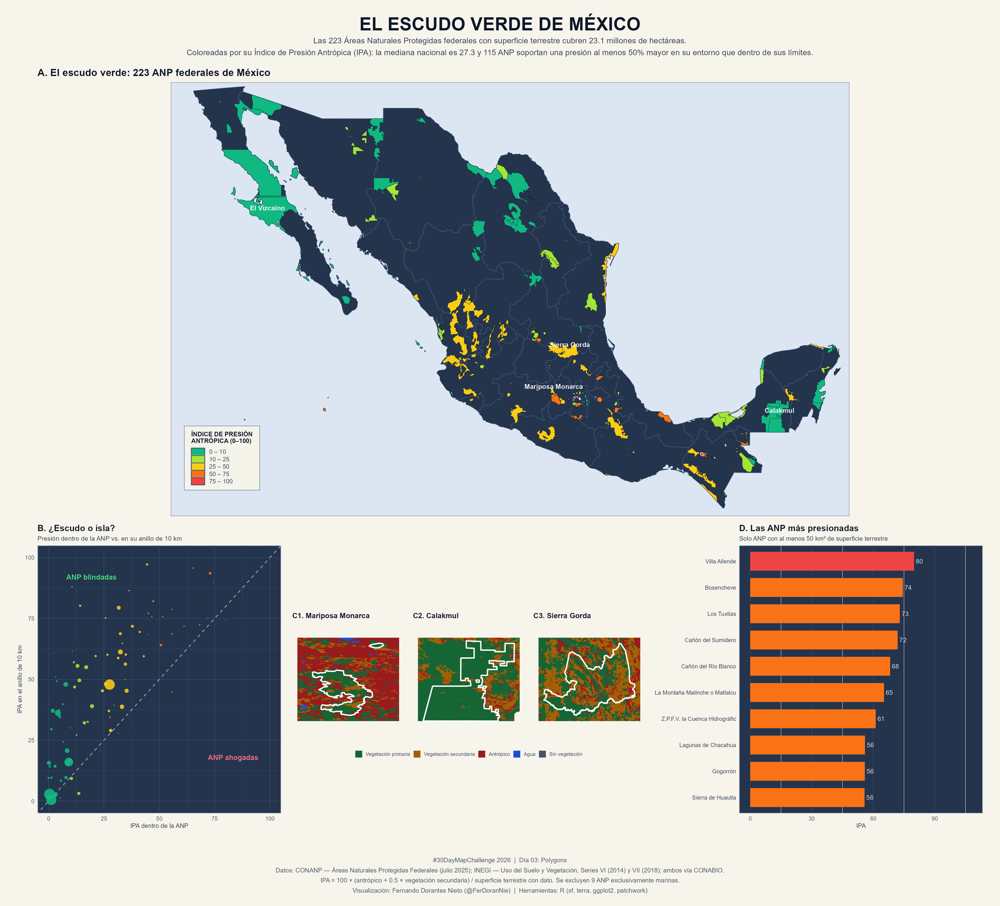
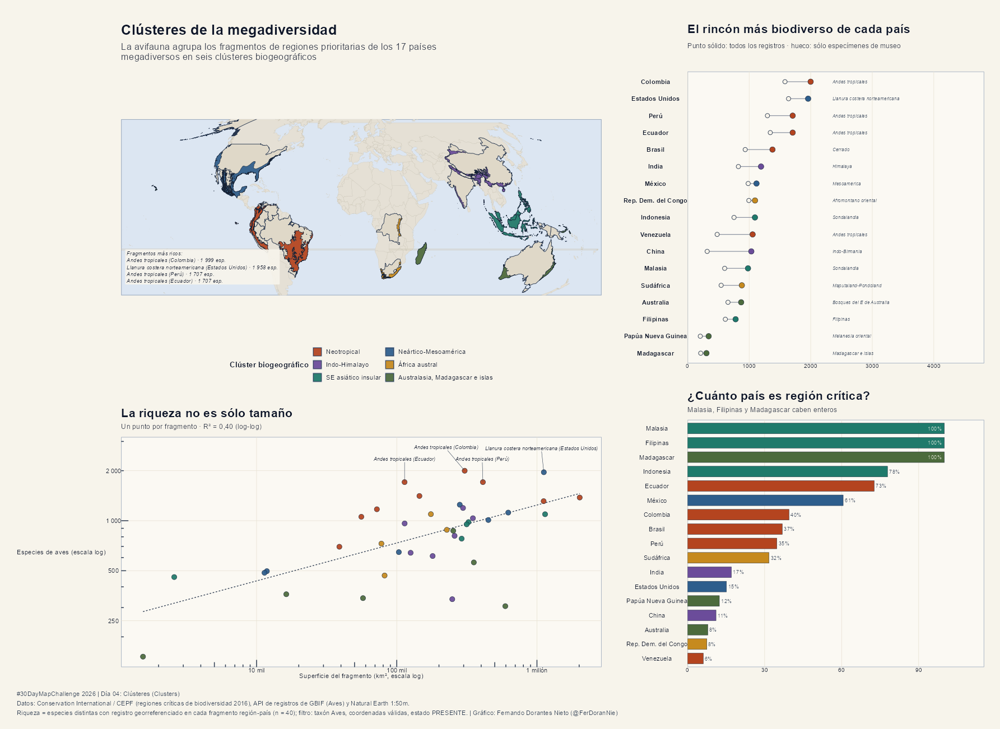
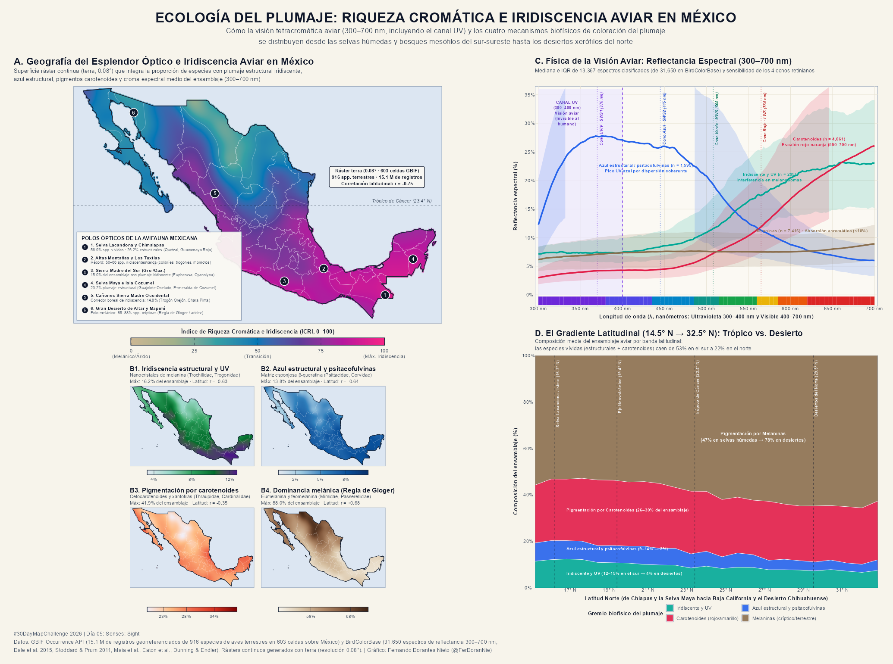

# 🗺️ #30DayMapChallenge 2026

Repositorio oficial de mi participación en el **#30DayMapChallenge 2026** (noviembre de 2026). Esta es mi **tercera edición consecutiva** participando en el reto cartográfico creado por Topi Tjukanov:

- 📁 **Edición 2025:** [FerDoranNie/-Repo30DayMapChallenge2025](https://github.com/FerDoranNie/-Repo30DayMapChallenge2025)
- 📁 **Edición 2024:** [FerDoranNie/Repo30DayMapChallenge2024](https://github.com/FerDoranNie/Repo30DayMapChallenge2024)

---

## 🎯 Ejes Temáticos de la Edición 2026

En esta edición los 30 mapas giran alrededor de cuatro grandes líneas de investigación y visualización espacial:

1. **🌍 Biodiversidad y Problemas Ambientales Mundiales:** Riqueza de especies, países megadiversos, deforestación, conectividad ecológica y conservación global.
2. **🇲🇽 México (Demografía, Sociedad y Medio Ambiente):** Desigualdad urbana (como la hipótesis del *Poniente rico* en las metrópolis mexicanas), estrés hídrico, transición urbano-rural e islas de calor.
3. **🦜 Información sobre Aves:** Endemismo en México, rutas migratorias continentales, ecología del plumaje, paisajes sonoros y ciencia ciudadana.
4. **💡 Datos Curiosos y Exploraciones Creativas:** Cartografía borgesiana, topónimos animales, mapas históricos estilo *vintage* y visualizaciones experimentales.

---

## 🛠️ Herramientas y Stack Tecnológico

- **R:** `sf`, `terra`, `stars`, `ggplot2`, `tmap`, `rayshader`, `biscale`, `ggridges`, `rgbif`
- **Python:** `geopandas`, `rasterio`, `xarray`, `matplotlib`, `leafmap`, `pydeck`, `h3`, `osmnx`, `duckdb`
- **SIG de Escritorio y Diseño:** QGIS, ArcGIS, Blender
- **Web / Interactivo:** Leaflet, MapLibre GL, Deck.gl, Observable, Quarto / Shiny

---

## 📅 Calendario y Progreso de los 30 Días

| Día | Fecha | Tema Oficial | Eje Temático | Mapa / Proyecto | Herramientas | Código | Estado |
| :---: | :---: | :--- | :--- | :--- | :--- | :---: | :---: |
| **01** | 01 Nov | **Points** | 🦜 Aves | Endemismo alado en México (~110 especies endémicas) | R (`sf`, `ggplot2`) | [`day01`](./days/day01_points/) | ✅ Publicado |
| **02** | 02 Nov | **Lines** | 🦜 Aves | Autopistas del cielo: Veracruz Río de Rapaces y el embudo migratorio de América | Python (`pandas`, `shapely`, `scipy`, `matplotlib`) | [`day02`](./days/day02_lines/) | ✅ Publicado |
| **03** | 03 Nov | **Polygons** | 🇲🇽 México | El escudo verde de México: 223 ANP y presión antrópica | R (`sf`, `terra`, `ggplot2`) | [`day03`](./days/day03_polygons/) | ✅ Publicado |
| **04** | 04 Nov | **Clusters** | 🌍 Bio/Amb | Clústeres de la megadiversidad: la zona más biodiversa de los 17 países más biodiversos | R (`sf`, `ggplot2`, `patchwork`, `cluster`) + GBIF API | [`day04`](./days/day04_clusters/) | ✅ Publicado |
| **05** | 05 Nov | **Senses: Sight** | 🦜 Aves | Ecología del plumaje: Riqueza cromática e iridiscencia aviar en México | R (`terra`, `sf`, `ggplot2`, `patchwork`) + GBIF & BirdColorBase | [`day05`](./days/day05_senses_sight/) | ✅ Publicado |
| **06** | 06 Nov | **Vintage** | 🌍 Bio/Amb | Cuatro naturalistas, cuatro rutas: Darwin, Humboldt, Wallace y Helia Bravo | R (`sf`, `ggplot2`, `patchwork`, `gifski`) + GBIF | [`day06`](./days/day06_vintage/) | ⏳ Pendiente |
| **07** | 07 Nov | **10 minute map** | 🇲🇽 México | ¿Dónde tiembla en México? Densidad sísmica / Cenotes | Python (`leafmap`) | [`day07`](./days/day07_10_minute_map/) | ⏳ Pendiente |
| **08** | 08 Nov | **Utopia** | 🌍 Bio/Amb | Planeta 30x30: Corredores biológicos y restauración ecológica | R (`terra`, `sf`) | [`day08`](./days/day08_utopia/) | ⏳ Pendiente |
| **09** | 09 Nov | **Urban-rural** | 🇲🇽 México | La frontera que devora el bosque: Expansión metropolitana en México | R (`biscale`) | [`day09`](./days/day09_urban_rural/) | ⏳ Pendiente |
| **10** | 10 Nov | **Prompting only** | 💡 Curioso | Geografía de los topónimos de fauna y flora en localidades de México | R / Python | [`day10`](./days/day10_prompting_only/) | ⏳ Pendiente |
| **11** | 11 Nov | **Senses: Sound** | 🦜 Aves | El paisaje sonoro del amanecer: Cantos de aves (Xeno-canto) | Web (`Leaflet` / `Quarto`) | [`day11`](./days/day11_senses_sound/) | ⏳ Pendiente |
| **12** | 12 Nov | **Power** | 🇲🇽 México | ⭐ **¿El Poniente siempre es más rico? Geografía socioeconómica en ciudades mexicanas** | R (`sf`, `ggplot2`) / Web | [`day12`](./days/day12_power/) | ⏳ Pendiente |
| **13** | 13 Nov | **Interactions** | 🌍 Bio/Amb | Redes de interacción biológica / Comercio global de fauna silvestre | Deck.gl / R (`ggraph`) | [`day13`](./days/day13_interactions/) | ⏳ Pendiente |
| **14** | 14 Nov | **Borgesian map** | 💡 Curioso | El Aleph de las Ecorregiones: Mapa caligráfico con nombres científicos | R / Python | [`day14`](./days/day14_borgesian_map/) | ⏳ Pendiente |
| **15** | 15 Nov | **Inside out** | 🇲🇽 México | El Valle de México invertido: Topografía, cuenca lacustre y hundimiento | R (`rayshader`) | [`day15`](./days/day15_inside_out/) | ⏳ Pendiente |
| **16** | 16 Nov | **Collaborative map** | 🦜 Aves | El poder de la ciencia ciudadana: Naturalista y eBird en México | Python (`datashader`) | [`day16`](./days/day16_collaborative_map/) | ⏳ Pendiente |
| **17** | 17 Nov | **Light & dark** | 🦜 Aves | Trampas de luz en la noche: Contaminación lumínica vs. migración nocturna | R (`terra`, `ggplot2`) | [`day17`](./days/day17_light_and_dark/) | ⏳ Pendiente |
| **18** | 18 Nov | **NULL** | 🌍 Bio/Amb | Terra Incognita Biológica: Vacíos de muestreo (`NULL` en GBIF) | Python / R | [`day18`](./days/day18_null/) | ⏳ Pendiente |
| **19** | 19 Nov | **Senses: Smell** | 🇲🇽 México | ¿A qué huele la ciudad? Paisaje olfativo urbano (emisiones vs. panaderías/taquerías) | R (`sf`, `ggplot2`) | [`day19`](./days/day19_senses_smell/) | ⏳ Pendiente |
| **20** | 20 Nov | **Hexagons** | 🌍 Bio/Amb | Mosaico H3 de crisis y vida: Deforestación vs. riqueza de especies | Python (`h3`, `pydeck`) | [`day20`](./days/day20_hexagons/) | ⏳ Pendiente |
| **21** | 21 Nov | **OpenStreetMap** | 🇲🇽 México | Oasis urbanos: Accesibilidad peatonal a áreas verdes en ciudades de México | Python (`osmnx`) | [`day21`](./days/day21_openstreetmap/) | ⏳ Pendiente |
| **22** | 22 Nov | **Projections** | 🦜 Aves | El mundo visto por el Charrán Ártico (*Sterna paradisaea*) de polo a polo | R (`sf`) | [`day22`](./days/day22_projections/) | ⏳ Pendiente |
| **23** | 23 Nov | **Senses: Taste** | 🇲🇽 México | Centro Vavilov: Razas nativas de maíz, chiles, cacao y Denominaciones de Origen | R / QGIS | [`day23`](./days/day23_senses_taste/) | ⏳ Pendiente |
| **24** | 24 Nov | **Network** | 🌍 Bio/Amb | Ríos conectados y fragmentados: Cuencas hidrográficas por orden de Strahler | R (`sf`, `ggplot2`) | [`day24`](./days/day24_network/) | ⏳ Pendiente |
| **25** | 25 Nov | **Is this a map?** | 💡 Curioso | Paisajes de crestas (*joyplot*) de anomalías térmicas / espectrogramas aviares | R (`ggridges`) | [`day25`](./days/day25_is_this_a_map/) | ⏳ Pendiente |
| **26** | 26 Nov | **Water** | 🇲🇽 México | La sed de un país: Estrés hídrico y sobreexplotación de acuíferos en México | R (`sf`, `tmap`) | [`day26`](./days/day26_water/) | ⏳ Pendiente |
| **27** | 27 Nov | **New tool** | 🌍 Bio/Amb | Exploración masiva de biodiversidad con DuckDB Spatial + Lonboard / MapLibre | Python (`lonboard`) | [`day27`](./days/day27_new_tool/) | ⏳ Pendiente |
| **28** | 28 Nov | **Senses: Feeling** | 🇲🇽 México | Islas de calor urbano y vulnerabilidad térmica en ciudades mexicanas | Python / R (`terra`) | [`day28`](./days/day28_senses_feeling/) | ⏳ Pendiente |
| **29** | 29 Nov | **Raster** | 🌍 Bio/Amb | Altura del dosel forestal y relieve sombreado en bosques mesófilos | R (`terra`, `rayshader`) | [`day29`](./days/day29_raster/) | ⏳ Pendiente |
| **30** | 30 Nov | **Pen & paper** | 🦜 Aves | Cuaderno de campo de un naturalista: Mapa dibujado a mano de ruta de aves | Pluma, papel y tinta | [`day30`](./days/day30_pen_and_paper/) | ⏳ Pendiente |

---

## 📂 Estructura del Proyecto

```text
Repo30DayMapChallenge2026/
├── README.md                  # Documentación general, calendario y galería visual
├── utils/                     # Plantillas de estilo y funciones auxiliares en R y Python
│   ├── theme_map2026.R
│   └── theme_map2026.py
├── data/                      # Datos crudos y procesados (ignorados en Git por tamaño)
│   ├── raw/
│   └── processed/
├── days/                      # Código reproducible y notas para cada uno de los 30 días
│   ├── day01_points/
│   ├── ...
│   └── day30_pen_and_paper/
└── outputs/                   # Mapas exportados
    ├── gallery/               # Imágenes optimizadas para la galería de este README
    └── high_res/              # Salidas en alta resolución
```

---

## 🖼️ Galería de Mapas

### Día 1
#### Constelaciones del endemismo aviar en México


### Día 2
#### Veracruz Río de Rapaces


### Día 3
#### Estado actual de las áreas protegidas de México


### Día 4
#### Centros de biodiversidad en los países megadiversos


### Día 5
#### Ecología del plumaje: riqueza cromática e iridiscencia aviar en México



---

## 👤 Autor

**Fernando Dorantes Nieto**
- GitHub: [@FerDoranNie](https://github.com/FerDoranNie)
