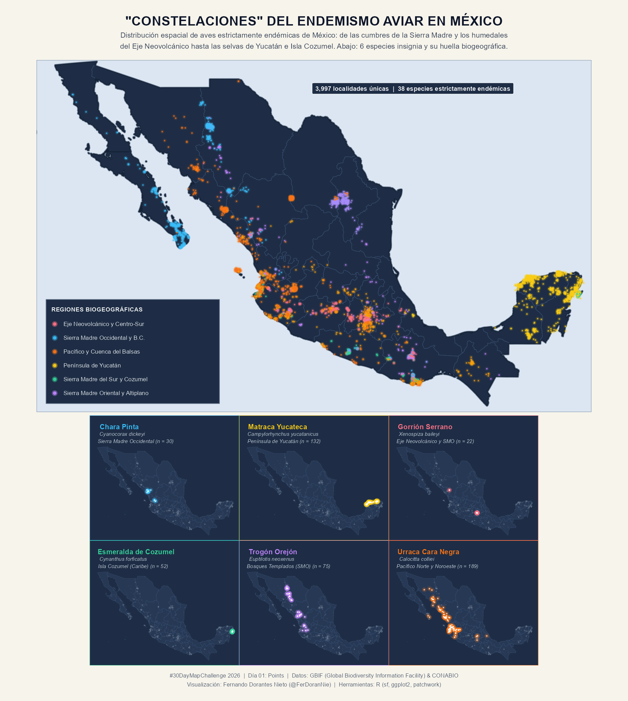

# Día 01 — Points (01 de noviembre de 2026)

- **Título:** Constelaciones del Endemismo Alado en México
- **Eje temático:** 🦜 Información sobre Aves
- **Herramientas:** R (`sf`, `ggplot2`, `patchwork`, `httr`, `jsonlite`)
- **Fuentes de datos:** API de Ocurrencias de GBIF (Global Biodiversity Information Facility) y listado taxonómico de especies endémicas de México (CONABIO / eBird).

## Metodología y Diseño

1. **Consulta a la API de GBIF:** El script [`day01_aves_endemicas.R`](./day01_aves_endemicas.R) consulta automáticamente el *Backbone Taxonómico* y la API de ocurrencias de GBIF para 38 especies representativas estrictamente endémicas de México (restringidas a registros dentro del país sin problemas geoespaciales, deduplicados en una malla de ~1 km), sumando **3,997 localidades únicas**.
2. **Especies Bandera (Paneles Inferiores):**
   - **Chara Pinta (*Cyanocorax dickeyi*):** Bosques de pino-encino de la Sierra Madre Occidental (Sinaloa, Durango y Nayarit).
   - **Matraca Yucateca (*Campylorhynchus yucatanicus*):** Matorral costero y dunas del norte de Yucatán.
   - **Gorrión Serrano (*Xenospiza baileyi*):** Pastizales subalpinos de zacatón en el Eje Neovolcánico y Durango.
   - **Esmeralda de Cozumel (*Cynanthus forficatus*):** Endémica insular exclusiva de la Isla Cozumel, Quintana Roo.
   - **Trogón Orejón (*Euptilotis neoxenus*):** Bosques templados de montaña en la Sierra Madre Occidental.
   - **Urraca Cara Negra (*Calocitta colliei*):** Selvas secas de la vertiente del Pacífico Norte y Noroeste.
3. **Estética ("Constelaciones"):** Se superponen tres capas de puntos con distintos radios y opacidades (`alpha = 0.08`, `0.22` y `0.85`) sobre un lienzo azul profundo (`#070b19`) para generar un efecto de luminiscencia por provincia biogeográfica.

## Vista Previa

