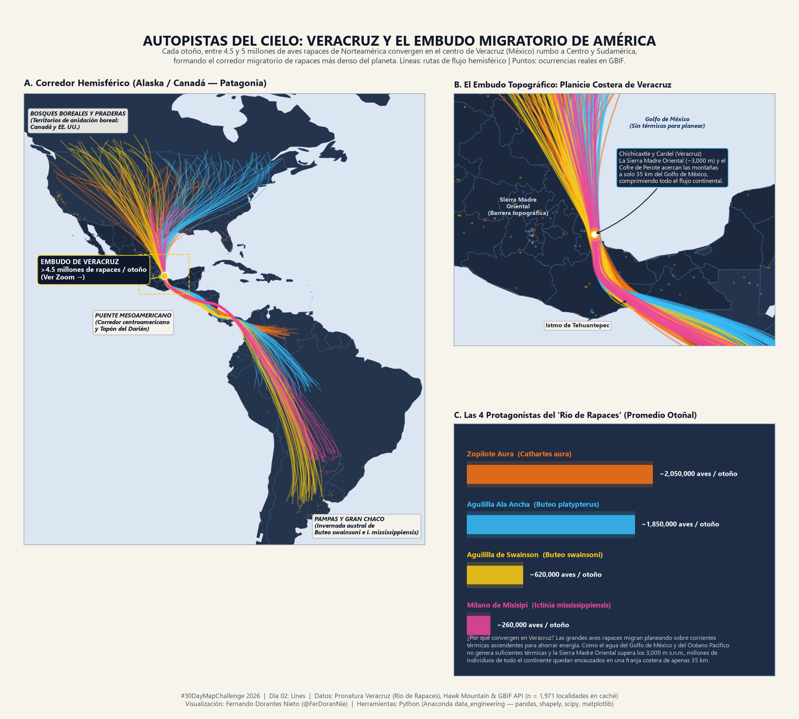

# Día 02 — Lines (02 de noviembre de 2026)

- **Título:** Autopistas del Cielo: Veracruz y el Embudo Migratorio de América
- **Eje temático:** 🦜 Información sobre Aves
- **Herramientas:** Python (`pandas`, `pyarrow`, `shapely`, `scipy`, `matplotlib`) ejecutado en el entorno `data_engineering` de Anaconda.
- **Fuentes de datos:** Monitoreo histórico de *Veracruz Río de Rapaces* (Pronatura Veracruz / Hawk Mountain Sanctuary), API de ocurrencias de GBIF (`n = 1,971` localidades en América) y límites continentales de Natural Earth.

## Metodología y Diseño

1. **Fenómeno Biogeográfico:** Cada otoño, entre 4.5 y 5 millones de aves rapaces de Norteamérica migran hacia Centro y Sudamérica. Debido a que planean utilizando corrientes térmicas ascendentes (ausentes sobre el Golfo de México y el Océano Pacífico) y a que el Eje Neovolcánico y la Sierra Madre Oriental (~3,000 m s.n.m.) se estrechan a solo 35 km del mar a la altura de **Chichicaxtle y Cardel (Veracruz)**, se forma el corredor migratorio de rapaces más denso del planeta.
2. **Caché Local (`.parquet`):**
   - `data/processed/day02_raptors_gbif_americas.parquet`: Ocurrencias reales en el continente americano consultadas en la API de GBIF (no vuelve a consultar la API si el archivo ya existe).
   - `data/processed/day02_raptors_migration_lines.parquet`: 166 trayectorias interpoladas mediante splines cúbicos (`scipy.interpolate.make_interp_spline`) pasando por los cuellos de botella topográficos reales (Planicie Costera de Veracruz, Istmo de Tehuantepec y Tapón del Darién).
3. **Las 4 Especies Protagonistas:**
   - **Zopilote Aura (*Cathartes aura*):** ~2,050,000 individuos por otoño.
   - **Aguililla Ala Ancha (*Buteo platypterus*):** ~1,850,000 individuos por otoño.
   - **Aguililla de Swainson (*Buteo swainsoni*):** ~620,000 individuos por otoño (viajando desde las praderas de Canadá hasta las Pampas de Argentina).
   - **Milano de Misisipi (*Ictinia mississippiensis*):** ~260,000 individuos por otoño.

## Vista Previa

