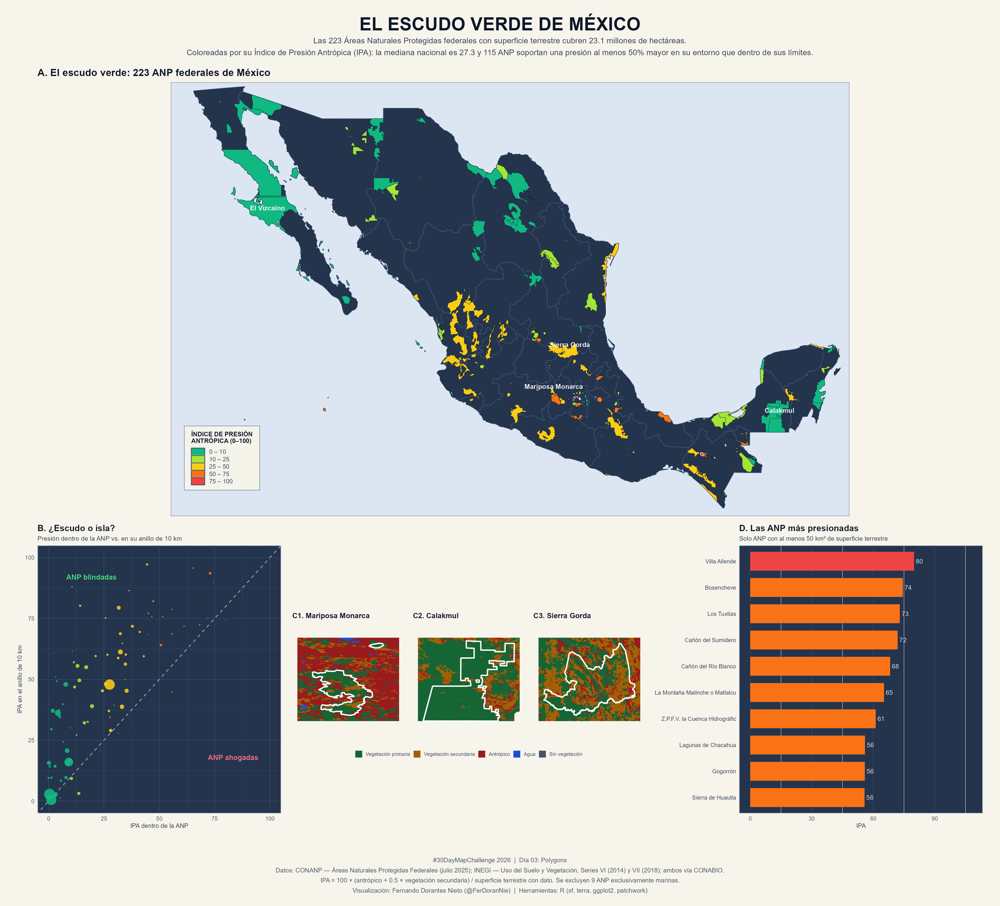

# Día 03 — Polygons (03 de noviembre de 2026)

- **Título:** El escudo verde de México — ¿qué protege realmente la red federal de ANP?
- **Eje temático:** 🇲🇽 México (Demografía, Sociedad y Medio Ambiente)
- **Herramientas:** R (`sf`, `terra`, `ggplot2`, `patchwork`, `foreign`) ejecutado con `Rscript.exe` de R 4.3.2 y la librería de usuario.
- **Fuentes de datos:**
  - **CONANP (julio 2025):** Áreas Naturales Protegidas Federales de México, distribuidas por el [Geoportal CONABIO](http://geoportal.conabio.gob.mx/metadatos/doc/html/anpjul2025gw.html) — 232 polígonos.
  - **INEGI — Serie VII (2018):** Uso del Suelo y Vegetación 1:250 000, vía [CONABIO](http://geoportal.conabio.gob.mx/metadatos/doc/html/usv250s7gw.html).
  - **INEGI — Serie VI (2014):** Uso del Suelo y Vegetación 1:250 000, vía [CONABIO](http://geoportal.conabio.gob.mx/metadatos/doc/html/usv250s6gw.html).
  - **Contexto estatal:** GeoJSON de estados ya usado en el Día 01 (`data/raw/day01/mexico_states.geojson`).

## Concepto

Cada Área Natural Protegida es un **polígono** coloreado por su **Índice de Presión Antrópica (IPA)**, calculado a partir del uso de suelo dentro de sus límites. La historia no es "cuántas ANP hay", sino **islas de vegetación primaria en una matriz de presión**: al comparar el IPA interno contra el del anillo de 10 km que rodea a cada ANP se obtiene el **efecto blindaje**.

## Metodología

1. **Descarga con caché** desde CONABIO a `data/raw/day03/` (los `.zip` no se vuelven a descargar).
2. **Clasificación por descripción, no por código:** la Serie VII usa códigos compuestos de 11 dígitos (183 clases) que no corresponden a la clave INEGI de 3 dígitos. Las 181–183 descripciones distintas se agrupan en cinco macro-clases: *vegetación primaria*, *vegetación secundaria*, *antrópico* (agricultura, pastizal inducido/cultivado, asentamientos humanos, urbano construido), *agua* y *sin vegetación*.
3. **Rasterización a 0.0025° (~250 m)** con `terra` sobre una plantilla nacional: intersectar los ~179 mil polígonos habría sido inviable; el raster permite además calcular superficies reales con `cellSize()`.
4. **Estadísticas zonales** con `extract(weights = TRUE)`: cada celda aporta su fracción de área dentro del polígono, de modo que las ANP pequeñas no quedan sobrerrepresentadas.
5. **Anillo de 10 km** en proyección métrica (EPSG:6372), restando la unión de todas las ANP para no duplicar superficie protegida.
6. **Métricas:**
   - `IPA = 100 × (antrópico + 0.5 × secundaria) / superficie terrestre con dato`
   - `blindaje = IPA del anillo / IPA de la ANP`
   - `pérdida bruta de primaria = % de la vegetación primaria de 2014 que en 2018 era otra clase`

## Hallazgos

| Indicador | Dentro de las ANP | En el anillo de 10 km |
| :--- | ---: | ---: |
| Vegetación primaria | **77.7 %** | 43.6 % |
| Vegetación secundaria | 15.1 % | 23.5 % |
| Antrópico | **7.2 %** | 32.8 % |

- Las **223 ANP con superficie terrestre** suman **23.1 Mha** (≈12 % del país) y concentran el **17.9 % de la vegetación primaria nacional**: la red protege casi una quinta parte del remanente primario en una octava parte del territorio.
- La presión antrópica en el entorno es **4.6 veces** la interna; el **blindaje mediano es de 1.72** y **115 ANP** soportan al menos 50 % más presión afuera que adentro.
- Mediana nacional del IPA: **26.4** (56.3 en los anillos).
- Por categoría, las **Reservas de la Biosfera** son las mejor libradas (IPA mediano 13.5; 78.9 % de vegetación primaria) y los **Parques Nacionales** los más presionados (IPA 47.1), en buena medida porque son pequeños y muchos están dentro o junto a ciudades.
- Casos críticos de pérdida bruta de primaria 2014–2018: **Lagunas de Chacahua (51.9 %)** y **La Michilía (45.3 %)**.

## Advertencia metodológica

Las series VI y VII de INEGI **no son un ejercicio de detección de cambio**: son interpretaciones independientes. Al compararlas celda por celda coinciden en **95.9 %** del territorio, pero el balance neto nacional es engañoso (la vegetación primaria "sube" 3,012 km² y lo antrópico "baja" 3,111 km²) porque las ganancias por reclasificación cancelan las pérdidas. Por eso el mapa usa el **estado 2018** como variable principal y mide **pérdida bruta** —no balance neto— cuando recurre a la dimensión temporal.

Otras notas:

- Se excluyen del índice **9 ANP exclusivamente marinas** (incluida *Pacífico Mexicano Profundo*, 43.8 Mha).
- El raster de 250 m no resuelve bien las ANP insulares pequeñas; 62 ANP tienen menos de 5 km² de superficie terrestre y su IPA es menos fiable.
- Licencia de los datos: CC BY-NC 2.5 MX (CONABIO). Citar a CONANP, INEGI y CONABIO.

## Estructura del póster

| Panel | Contenido |
| :--- | :--- |
| **A** | Mapa nacional: 223 ANP coloreadas por IPA, con cuatro hitos etiquetados |
| **B** | Dispersión IPA interno vs. IPA del anillo (las ANP por encima de la diagonal están "blindadas") |
| **C** | Tres acercamientos al mosaico de uso de suelo: Mariposa Monarca, Calakmul y Sierra Gorda |
| **D** | Las 10 ANP más presionadas (solo con ≥50 km² terrestres) |

## Archivos generados

- Script: [`day03_anp_presion.R`](./day03_anp_presion.R)
- Datos: `data/processed/day03_anp_indice.rds`, `data/processed/day03_usv250s{6,7}gw_clases.tif`
- Salidas: `outputs/high_res/day03_polygons_anp_presion.png` y `outputs/gallery/day03_polygons_anp_presion.png`

## Vista Previa

