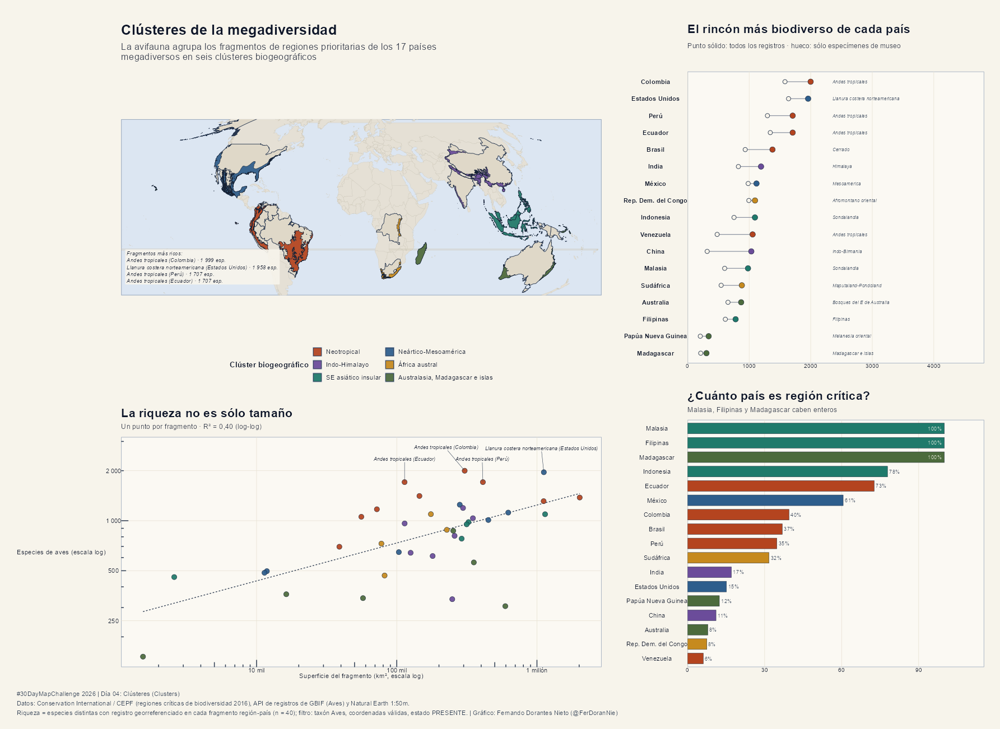

# Día 04 — Clusters (04 de noviembre de 2026)

- **Título:** Clústeres de la megadiversidad — la zona más biodiversa de los países más biodiversos
- **Eje temático:** 🌍 Biodiversidad y Problemas Ambientales Mundiales
- **Herramientas:** R (`sf`, `ggplot2`, `patchwork`, `cluster`, `httr`) y la API de ocurrencias de GBIF.
- **Fuentes de datos:**
  - **Conservation International / CEPF (2016):** 36 hotspots de biodiversidad, servidos como *Feature Service* de ArcGIS (`Biodiversity_Hotspots_2016`). 53 features que se disuelven en 36 hotspots.
  - **GBIF Occurrence API:** riqueza de aves (clase Aves, `taxonKey = 212`) por geometría, con faceta `speciesKey`.
  - **Natural Earth 1:50m:** límites nacionales.

## Concepto

El reto del día es **Clusters**, así que el mapa no se limita a pintar hotspots: los **agrupa**. La pregunta es doble: *¿cuál es la zona más biodiversa dentro de cada uno de los 17 países megadiversos?* y *¿esas zonas se parecen entre sí lo suficiente como para formar clústeres biogeográficos?*

La unidad de análisis es el **fragmento hotspot-país**: la porción de un hotspot de biodiversidad que cae dentro de un país megadiverso. De los 36 hotspots, **26 tocan alguno de los 17 países** y generan **40 fragmentos**.

## Metodología

1. **Universo de países.** Los 17 países megadiversos de Mittermeier et al. (1997): Australia, Brasil, China, Colombia, R.D. del Congo, Ecuador, EE. UU., Filipinas, India, Indonesia, Madagascar, Malasia, México, Papúa Nueva Guinea, Perú, Sudáfrica y Venezuela.
2. **Hotspots disueltos.** Las 53 features se agrupan por nombre y se unen (`st_union`) para obtener los 36 hotspots reales. El área geodésica calculada (107.3 M km²) coincide con la suma de atributos del servicio (107.0 M km²) a 0.3 %.
3. **Intersección.** Se intersectan hotspots y países en EPSG:4326 y se descartan astillas menores a 1 km².
4. **Riqueza por fragmento.** Para cada fragmento se consulta GBIF con faceta `speciesKey` (todas las especies distintas con registro georreferenciado, `occurrenceStatus = PRESENT`, sin problemas geoespaciales). Se repite el ejercicio restringido a `basisOfRecord = PRESERVED_SPECIMEN` como control del sesgo de muestreo.
5. **Tres límites de la API que condicionaron el diseño** (documentados aquí porque cuestan horas de depuración):
   - La **URL** no puede pasar de ~4 KB: por encima, GBIF responde `400 Bad Request` sin mensaje útil.
   - Los **multipolígonos grandes** fallan en el parser espacial (`spatial4j`), y exige anillos exteriores antihorarios y huecos horarios.
   - Por eso cada fragmento se **descompone en polígonos simples** (simplificación de 5 km con `s2`, componentes que suman 99.5 % del área), se consultan por separado y se **unen las listas de especies**.
6. **Clústeres.** Matriz binaria fragmento × especie (6 214 especies presentes en ≥2 fragmentos), distancia de **Jaccard** y aglomeración **Ward.D2**. El número de grupos se elige por **silueta media** (k = 2…10, descartando soluciones con grupos de 1–2 miembros) → **k = 6**.

## Hallazgos

| Clúster | Fragmentos | Riqueza mediana |
| :--- | ---: | ---: |
| 1. Neotropical (Andes y Brasil) | 9 | **1 379** |
| 2. Neártico y Mesoamérica | 7 | 1 010 |
| 3. Indo-Himalayo | 7 | 811 |
| 4. África austral | 4 | 804 |
| 5. Sudeste asiático insular | 5 | 951 |
| 6. Australasia, Madagascar e islas | 6 | 351 |

- **La zona más biodiversa del planeta (en aves documentadas)** es el fragmento de los **Andes tropicales en Colombia: 1 999 especies**; le siguen la **llanura costera atlántica de EE. UU. (1 958)** y los Andes de **Perú (1 707)** y **Ecuador (1 707)**.
- **La zona más rica de cada país** tiene una mediana de **1 094 especies**, con un rango que va de **306 (Madagascar)** a **1 999 (Colombia)**. Los Andes tropicales son el fragmento más rico en **cuatro países** (Colombia, Ecuador, Perú y Venezuela) y Sundaland en dos (Indonesia y Malasia).
- **Riqueza ≠ tamaño:** el modelo especies-área explica sólo **R² = 0.40** en escala logarítmica, con una pendiente de **0.228**. Los fragmentos pequeños y muy muestreados (California, Madrean) superan a fragmentos varias veces mayores (Cerrado).
- **Los 40 fragmentos suman 368.7 millones de registros** de GBIF y **9 233 especies** distintas de aves.
- **Cobertura nacional:** Malasia, Filipinas y Madagascar están **100 %** dentro de un hotspot; la mediana de los 17 países es **34.7 %** y **7 de 17** dedican menos del 20 % de su territorio a hotspots.

## Advertencia metodológica

Este es un mapa de **avifauna documentada**, no de biodiversidad total, y eso tiene consecuencias:

- **Sesgo de muestreo.** La proporción de especies respaldadas por especímenes de museo va del **1.7 %** (Indo-Burma en Malasia) al **90.9 %** (Afromontano oriental). La llanura atlántica de EE. UU. acumula 142 millones de registros, en buena medida de ciencia ciudadana; su segundo puesto mide tanto observadores como aves. El panel D del póster muestra, para cada país, el punto hueco (sólo especímenes) junto al sólido (todos los registros).
- **Un solo taxón.** Las aves son el grupo mejor documentado de GBIF, pero no representan a plantas, anfibios o insectos, cuyos patrones de riqueza difieren.
- **Geometrías aproximadas.** Los polígonos se simplificaron a ~5 km y se partieron en componentes por límites de la API; el 0.5 % del área menor de cada fragmento se descartó.
- **Dos fragmentos quedaron fuera** del clustering por falta de datos: *Mesoamerica* en Colombia (astilla de ~1 km²) y *New Zealand* en Australia (99 km²).
- **Áreas del servicio CI.** Los polígonos de hotspot incluyen superficies marinas en algunos casos (Polinesia-Micronesia), así que las comparaciones de área entre hotspots son aproximadas; el ranking usa riqueza, no densidad.
- Madagascar se agrupa con las islas oceánicas y Australasia, no con África continental: es un resultado del Jaccard (su avifauna comparte pocas especies con el continente) y no un error de asignación.

## Estructura del póster

| Panel | Contenido |
| :--- | :--- |
| **A** | Mapamundi (Mollweide): los 40 fragmentos coloreados por clúster, con los 17 países megadiversos delineados |
| **B** | Riqueza de aves vs. superficie del fragmento (log-log) con la recta especies-área |
| **C** | Porcentaje del territorio de cada país megadiverso dentro de un hotspot |
| **D** | El fragmento más rico de cada país, con el control de especímenes de museo |

## Archivos generados

- Scripts: [`day04_megadiversidad.R`](./day04_megadiversidad.R) (datos) y [`day04_poster.R`](./day04_poster.R) (figura).
- Datos: `data/raw/day04/hotspots_ci2016.geojson`, `data/raw/day04/ne_50m_admin_0_countries.geojson`, `data/processed/day04_geometrias.rds`, `data/processed/day04_gbif_facetas.rds` y `data/processed/day04_dataset.rds`.
- Salidas: `outputs/high_res/day04_clusters_megadiversidad.png` y `outputs/gallery/day04_clusters_megadiversidad.png`.

## Vista Previa

