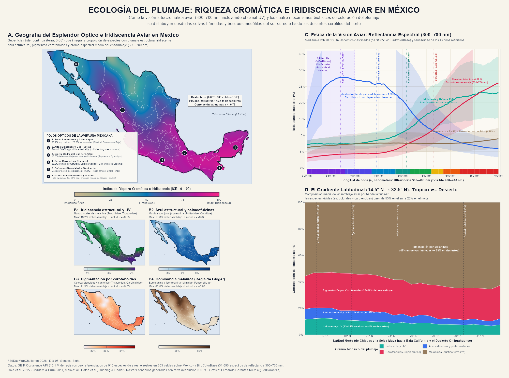

# Día 05 — Senses: Sight (05 de noviembre de 2026)

- **Título:** Ecología del plumaje: Riqueza cromática e iridiscencia aviar en México
- **Eje temático:** 🦜 Información sobre Aves
- **Herramientas:** R (`terra`, `sf`, `ggplot2`, `patchwork`, `curl`, `readxl`) + GBIF Occurrence API + BirdColorBase.
- **Fuentes de datos:**
  - **GBIF Occurrence API:** 15.1 millones de registros georreferenciados correspondientes a **916 especies de aves terrestres** en México, muestreados sobre una malla regular de **618 celdas de `0.6° × 0.6°`** (603 celdas con muestreo válido de $\ge 15$ especies).
  - **BirdColorBase (Espectrofotometría de museo, 300–700 nm):** **31,650 curvas de reflectancia espectral** (en pasos de 2 nm, cubriendo el canal ultravioleta aviar de 300–400 nm y el espectro visible de 400–700 nm) medidas en especímenes de museo para 824 especies y 135 familias (compilaciones de *Dale et al. 2015*, *Stoddard & Prum 2011*, *Maia et al.*, *Eaton et al.* y *Dunning & Endler*).
  - **CONABIO / INEGI:** División política estatal y línea de costa de México.

---

## Concepto y Marco Biofísico (*Senses: Sight*)

El sentido de la **vista en las aves** supera radicalmente al humano: las aves poseen una **retina tetracromática** con cuatro clases de conos fotorreceptores —sensibles al ultravioleta/violeta (`SWS1`, $\lambda_{\max} \approx 370\text{ nm}$), onda corta/azul (`SWS2`, $\approx 445\text{ nm}$), onda media/verde (`MWS`, $\approx 508\text{ nm}$) y onda larga/rojo (`LWS`, $\approx 565\text{ nm}$)— acoplados a gotas lipídicas que actúan como filtros espectrales de banda estrecha.

En la avifauna terrestre de México (**916 especies**), los colores que estimulan este sistema visual se producen mediante **cuatro grandes gremios biofísicos de coloración del plumaje** (Prum 2006; Stoddard & Prum 2011; Cooney et al. 2022; Delhey et al. 2023):

1. **Iridiscencia estructural y UV (Nanocristales de melanina y multicapas de $\beta$-queratina):**
   Interferencia constructiva de película delgada en melanosomas laminares o huecos que genera picos espectrales estrechos dependientes del ángulo de incidencia y alta reflectancia en UV, verde esmeralda, violeta o rubí. Representado en México por **115 especies** (1.71 M de registros), encabezadas por colibríes (`Trochilidae`), quetzales y trogones (`Trogonidae`), momotos (`Momotidae`) y jacamares (`Galbulidae`).
2. **Azul estructural no iridiscente y psitacofulvinas (Matriz esponjosa de $\beta$-queratina):**
   Dispersión coherente de luz en nanoestructuras cuasi-ordenadas de queratina esponjosa (azules y UV-azules puros) o combinadas con psitacofulvinas y xantofilas (verdes y turquesas estructurales). Representado por **83 especies** (0.91 M de registros): guacamayas, loros y pericos (`Psittacidae`), charas y urracas azules (`Corvidae`: *Cyanocorax*, *Cyanolyca*, *Aphelocoma*, *Calocitta*), cotingas (`Cotingidae`), saltarines (`Pipridae`) y colorines (*Passerina*, *Cyanocompsa*).
3. **Pigmentación por carotenoides (Señales dietarias de onda larga, 550–700 nm):**
   Xantofilas amarillas y cetocarotenoides rojos/naranjas metabolizados a partir de la dieta, que producen un escalón abrupto de reflectancia por encima de 550 nm. Representado por **192 especies** (4.71 M de registros): tangaras (`Thraupidae`), cardenales y pirangas (`Cardinalidae`), calandrias y zacuas (`Icteridae`), tucanes (`Ramphastidae`), chipes vivos (`Parulidae`: *Cardellina*, *Setophaga*, *Myioborus*) y carpinteros (`Picidae`).
4. **Pigmentación por melaninas (Eumelanina y feomelanina — Cripticismo y Regla de Gloger):**
   Curvas espectrales acromáticas o de pendiente suave (<10 % de reflectancia media) responsables de tonos pardos, grises, ocres y negros que confieren camuflaje de sotobosque o desierto, resistencia mecánica a la abrasión y fotoprotección UV. Representado por **526 especies** (7.80 M de registros): trepatroncos (`Furnariidae`), matracas y chivirines (`Troglodytidae`), cuitlacoches (`Mimidae`), gorriones y rascadores (`Passerellidae`), codornices (`Odontophoridae`), rapaces y búhos.

---

## Metodología

1. **Espectrofotometría (300–700 nm):** Se procesaron las 31,650 curvas de reflectancia espectral de `BirdColorBase` (`300` a `700 nm` cada `2 nm`), calculando para cada medición la fracción de reflectancia ultravioleta ($S_{\text{UV}}$, 300–400 nm), onda corta ($S_{\text{SW}}$, 300–500 nm), onda larga ($S_{\text{LW}}$, 600–700 nm), longitud de onda pico ($\lambda_{\max}$) y el **croma espectral relativo** $C_{\text{spec}} = (R_{\max} - R_{\min}) / \bar{R}$.
2. **Filtro de avifauna terrestre:** Siguiendo el estándar macroecológico (Dale et al. 2015 *Nature*; Cooney et al. 2022 *Nat. Ecol. Evol.*), se excluyeron órdenes marinos, playeros y acuáticos pelágicos (`Charadriiformes`, `Pelecaniformes`, `Suliformes`, `Procellariiformes`, `Anseriformes`, etc.) para evitar que el plumaje blanco/gris de aves marinas distorsione el gradiente óptico terrestre en los litorales.
3. **Malla espacial en GBIF (`0.6° × 0.6°`):** Se dividió el territorio continental e insular de México en **618 celdas**, consultando para cada una la faceta `speciesKey` de GBIF (`taxonKey = 212`, `country = MX`, `hasCoordinate = true`, `hasGeospatialIssue = false`, `occurrenceStatus = PRESENT`). Para las **603 celdas** con $\ge 15$ especies terrestres registradas se calculó la proporción de especies de cada gremio biofísico, el croma espectral medio del ensamblaje y el **Índice de Riqueza Cromática e Iridiscencia (ICRI, 0–100)**.
4. **Modelado ráster continuo con `terra` (`0.08°`):** Las métricas por celda se rasterizaron e interpolaron mediante suavizado focal gaussiano en dos pasadas (`terra::focal` con ventana gaussiana `d = 0.48°`) sobre un `SpatRaster` de `0.08°` (~9 km de resolución) enmascarado exactamente al polígono nacional de México (`terra::mask`).

---

## Hallazgos Principales

| Gremio Biofísico del Plumaje | Especies en México | Registros GBIF | % Mediano por Celda | Rango en México (%) | Correlación con Latitud ($r$) |
| :--- | ---: | ---: | ---: | ---: | ---: |
| **1. Iridiscencia estructural y UV** | 115 | 1,708,505 | 9.5 % | 0.0 – 16.2 % | **−0.627** |
| **2. Azul estructural y psitacofulvinas** | 83 | 908,331 | 6.3 % | 0.0 – 13.8 % | **−0.638** |
| **3. Pigmentación por carotenoides** | 192 | 4,713,245 | 26.1 % | 7.1 – 41.9 % | **−0.345** |
| **4. Melaninas (críptico / terrestre)** | 526 | 7,796,940 | 58.3 % | 43.1 – 88.0 % | **+0.679** |
| **Índice Compuesto (ICRI, 0–100)** | **916** | **15,127,021** | **64.7** | **0.0 – 100.0** | **−0.745** |

- **Fuerte gradiente latitudinal óptico ($r = -0.745$):** La proporción combinada de aves con coloración estructural e iridiscente cae de **23–26 %** del ensamblaje en la Selva Lacandona, Los Chimalapas y la Península de Yucatán a **< 6 %** en los desiertos del norte (Sonora, Baja California y Chihuahua).
- **Récord de riqueza iridiscente en el bosque mesófilo:** Las celdas de las **Altas Montañas de Veracruz, Zongolica y la Selva Zoque/Uxpanapa** concentran entre **56 y 66 especies iridiscentes por celda**, impulsadas por la radiación de colibríes (`Trochilidae`), trogones (`Trogonidae`) y momotos (`Momotidae`).
- **El corredor montañoso de la Sierra Madre Occidental:** A pesar de ubicarse al norte del Trópico de Cáncer ($23.4^\circ\text{N}$), las barrancas húmedas de Sinaloa, Durango y el suroeste de Chihuahua mantienen hasta **14.8 % de especies iridiscentes** (*Euptilotis neoxenus*, *Cyanocorax dickeyi*, *Ara militaris*), formando una península de color estructural que penetra hacia el norte bordeando el Desierto Chihuahuense.
- **Dominancia melánica en las zonas áridas ($r = +0.679$):** En el Gran Desierto de Altar (Sonora, $32.2^\circ\text{N}$) y el Bolsón de Mapimí (Chihuahua/Coahuila), entre el **82 % y el 88 %** de las especies terrestres pertenecen al gremio melánico (cuitlacoches `Mimidae`, gorriones `Passerellidae`, matracas `Troglodytidae`), donde la eumelanina y la feomelanina proveen camuflaje sobre sustratos desérticos, termorregulación y resistencia a la abrasión por polvo.

---

## Estructura del Póster

| Panel | Contenido |
| :--- | :--- |
| **A** | Mapa ráster continuo (`terra`, `0.08°`) del **Índice de Riqueza Cromática e Iridiscencia (ICRI)** en México con isolíneas y los 6 Polos Ópticos de la avifauna nacional |
| **B** | Mosaico $2 \times 2$ de rásters `terra` para los **4 gremios biofísicos del plumaje** (`B1` Iridiscencia y UV, `B2` Azul estructural y psitacofulvinas, `B3` Carotenoides, `B4` Melaninas) |
| **C** | **Física de la visión aviar (300–700 nm):** Curvas reales de reflectancia espectral (mediana e IQR de `BirdColorBase`), banda ultravioleta (300–400 nm) y sensibilidad de los 4 conos retinianos (`SWS1`, `SWS2`, `MWS`, `LWS`) |
| **D** | **Gradiente latitudinal en México ($14.5^\circ\text{N} \to 32.5^\circ\text{N}$):** Transición continua en la composición porcentual de los cuatro gremios ópticos desde la frontera sur hasta el desierto boreal |

---

## Archivos Generados

- Scripts: [`day05_data_pipeline.R`](./day05_data_pipeline.R) (procesamiento espectral, consultas GBIF y rásters `terra`) y [`day05_poster.R`](./day05_poster.R) (composición cartográfica).
- Datos procesados: `data/processed/day05_birdcolorbase_spectra.rds`, `data/processed/day05_mexico_species_catalog.rds`, `data/processed/day05_gbif_grid_facets.rds`, `data/processed/day05_dataset.rds` y `data/processed/day05_rasters.tif`.
- Salidas gráficas: `outputs/high_res/day05_senses_sight_plumaje.png` (300 dpi) y `outputs/gallery/day05_senses_sight_plumaje.png`.

## Vista Previa

