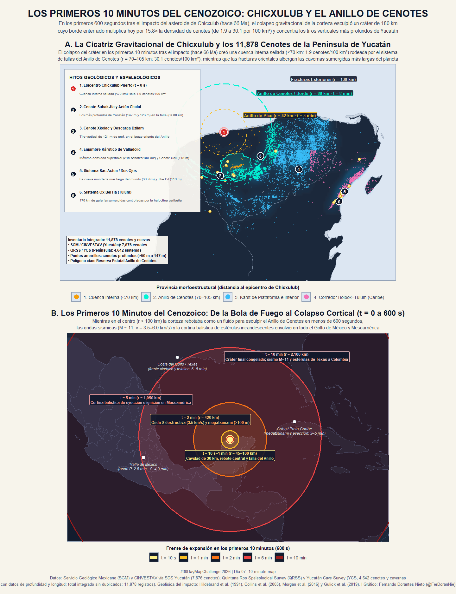

# Día 07 — 10 minute map (07 de noviembre de 2026)

- **Título:** Los primeros 10 minutos del Cenozoico: Chicxulub y el Anillo de Cenotes
- **Eje temático:** 🇲🇽 México / 🌍 Biodiversidad y Geología
- **Herramientas:** R (`sf`, `terra`, `ggplot2`, `patchwork`, `dplyr`) + Python (descarga vía ArcGIS REST API).
- **Fuentes de datos:**
  - **Servicio Geológico Mexicano (SGM) y CINVESTAV (vía Secretaría de Desarrollo Sustentable de Yucatán):** **7,876 cenotes** georreferenciados en el estado de Yucatán.
  - **Quintana Roo Speleological Survey (QRSS) y Yucatán Cave Survey (YCS, comp. Peter Sprouse):** **4,642 cenotes, cavernas y sistemas de ríos subterráneos** en Quintana Roo (3,211), Yucatán (1,366) y Campeche (39), incluyendo mediciones directas de profundidad máxima (`DEPTH`, en metros) y desarrollo horizontal explorado (`LENGTH`, en metros).
  - **Inventario Integrado sin Duplicados (`<120 m`):** **11,878 registros kársticos únicos** en la Península de Yucatán.
  - **SDS Yucatán / CONANP:** Polígono oficial de la *Reserva Estatal Geohidrológica del Anillo de Cenotes*.
  - **Modelos geofísicos del impacto de Chicxulub:** Hildebrand et al. (1991), Pope et al. (1996), Collins et al. (2005), Morgan et al. (2016, *Science*) y Gulick et al. (2019, *PNAS*).

---

## Resumen General

En Yucatán existe una formación geográfica fascinante llamada el **Anillo de Cenotes**, que es la huella visible desde la superficie del impacto del asteroide de **Chicxulub** (el que extinguió a los dinosaurios no aviares hace 66 millones de años). Dentro del círculo del cráter casi no se forman cenotes porque la cuenca quedó rellena y "sellada/compactada" por sedimentos poco permeables tras el impacto, mientras que justo alrededor del borde —donde la corteza colapsó y se fracturó— el agua subterránea disolvió la roca caliza formando un semicírculo perfecto de cenotes.

En este póster para el reto **Day 07: 10 minute map** se muestra:
1. **En el Panel A:** Cómo se ve hoy esa huella en la Península de Yucatán a través de **11,878 cenotes y cuevas inundadas** (el vacío dentro del cráter, el Anillo de Cenotes en el borde, el denso campo de Valladolid y los ríos subterráneos de Tulum).
2. **En el Panel B:** Lo que ocurrió durante los **primeros 10 minutos** después del impacto, cuando se formó esa estructura subterránea y las ondas de choque cubrieron todo el Golfo de México y Mesoamérica.

---

## Concepto: ¿Por qué "10 minutos"?

En lugar de interpretar el reto **10 minute map** únicamente como un mapa rápido, este proyecto cartografía **los 10 minutos más decisivos en la historia geológica y biológica de México y de la Tierra**: los primeros **600 segundos** tras el impacto del asteroide de Chicxulub ($21.30^\circ\text{ N}, 89.52^\circ\text{ W}$, hace 66 millones de años) y cómo la estructura cortical esculpida durante esos 10 minutos controla hoy la distribución espacial y la profundidad de los **11,878 cenotes y cavernas inundadas** de la Península de Yucatán:

1. **$t = 0\text{ a }10\text{ segundos}$ ($r \approx 45\text{ km}$):** El bólido de ~12 km de diámetro perfora la plataforma carbonatada maya y abre una cavidad transitoria de **30 km de profundidad** y ~100 km de ancho.
2. **$t = 1\text{ a }3\text{ minutos}$ ($r \approx 42\text{–}88\text{ km}$):** El fondo del cráter rebota gravitacionalmente como un fluido acústicamente fluidizado hasta elevarse >15 km sobre la superficie y colapsa hacia afuera para formar el **Anillo de Pico (*Peak Ring*, $r \approx 42\text{ km}$)**, mientras los bloques externos se deslizan por fallas lístricas formando el escarpe concéntrico que hoy subyace al **Anillo de Cenotes ($r \approx 80\text{–}95\text{ km}$)**.
3. **$t = 2\text{ a }5\text{ minutos}$ ($r = 420\text{ a }1,050\text{ km}$):** El frente destructivo de ondas sísmicas $S$ ($3.5\text{ km/s}$, magnitud equivalente $M_w \approx 11$), el megatsunami inicial (>100 m de altura en el Golfo de México) y la cortina balística de eyección envuelven todo el sureste de México, el Valle de México y el proto-Caribe.
4. **$t = 10\text{ minutos}$ ($r = 2,100\text{ km}$):** La morfología final del cráter multianillo (**180–200 km de diámetro**) queda congelada en la corteza terrestre, mientras el tren de ondas superficiales y la lluvia de esférulas incandescentes alcanzan desde Texas y Florida hasta el norte de Sudamérica.

---

## Metodología Paso a Paso

La construcción del mapa se dividió en **4 etapas geoespaciales** implementadas en [`day07_data_pipeline.R`](./day07_data_pipeline.R) y [`day07_poster.R`](./day07_poster.R):

1. **Integración y desduplicación de inventarios kársticos (`sf`):**
   - Se combinaron dos bases de datos complementarias: el censo estatal de **7,876 cenotes** del Servicio Geológico Mexicano (SGM) y CINVESTAV (enfocado en Yucatán) y el catálogo espeleológico de **4,642 cenotes y cavernas sumergidas** de QRSS y YCS (que cubre Quintana Roo, Yucatán y Campeche e incluye datos de profundidad y longitud de cuevas).
   - Para evitar contar dos veces el mismo cenote donde ambos catálogos se traslapan, se reproyectaron los puntos al sistema métrico oficial de México (`EPSG:6372`, ITRF2008 / LCC) y se aplicó un filtro de vecino más cercano (`st_distance`), descartando registros del SGM ubicados a menos de **120 metros** de un registro espeleológico de QRSS/YCS. Esto produjo un inventario único de **11,878 manifestaciones kársticas**.
2. **Geometría radial desde el epicentro de Chicxulub y clasificación morfoestructural:**
   - Tomando como origen el centro geofísico del cráter en **Chicxulub Puerto ($21.30^\circ\text{ N}, 89.52^\circ\text{ W}$)** (Hildebrand et al. 1991; Morgan et al. 2016), se calculó la distancia radial euclidiana ($r$, en km) de cada uno de los 11,878 cenotes y se trazaron los tres anillos estructurales del cráter enterrado: el **Anillo de Pico ($r = 42\text{ km}$)**, el **Borde Principal / Anillo de Cenotes ($r = 88\text{ km}$)** y las **Fracturas Exteriores ($r = 130\text{ km}$)**.
   - Con base en esta distancia y en los dominios tectónicos de la península, cada punto se clasificó en **4 provincias hidrogeológicas** (Cuenca Interna $<70\text{ km}$, Anillo de Cenotes $70\text{–}105\text{ km}$, Karst de Plataforma Oriental y Corredor Holbox–Tulum).
3. **Cálculo de densidad real por anillo concéntrico y superficie ráster (`terra`):**
   - Dado que una parte del cráter está bajo el Golfo de México, contar solo el número bruto de cenotes sesgaría el resultado. Por ello, se generaron anillos concéntricos cada **5 km** (`st_buffer` y `st_difference`) y se recortaron contra el polígono continental de la Península (`st_intersection`) para obtener la **densidad terrestre efectiva ($\text{cenotes} / 100\text{ km}^2$ de tierra firme)**.
   - En paralelo, se rasterizó la nube de puntos sobre una malla de `0.035°` (~3.8 km) aplicando un suavizado focal gaussiano (`terra::focal`) como halo de fondo en el Panel A.
4. **Modelado de isócronas de los primeros 10 minutos (Panel B):**
   - Utilizando una **proyección acimutal equidistante** centrada exactamente en Chicxulub (`+proj=aeqd +lat_0=21.30 +lon_0=-89.52`), se construyeron los frentes de propagación física entre **$t = 10\text{ s}$ y $t = 10\text{ min}$ (600 s)** a partir de las velocidades sísmicas corticales ($v_S \approx 3.5\text{ km/s}$) y los modelos hidrodinámicos del colapso del cráter (Collins et al. 2005; Gulick et al. 2019).

---

## Hallazgos Cuantitativos en los Datos

Al cruzar los **11,878 cenotes y cavernas** con la distancia radial al epicentro geofísico de Chicxulub Puerto ($21.30^\circ\text{ N}, 89.52^\circ\text{ W}$) y normalizar por la **superficie terrestre emergida real** de cada anillo concéntrico de 5 km (`EPSG:6372`), emergen cuatro provincias hidrogeológicas claramente diferenciadas:

| Provincia Morfoestructural | Distancia al Epicentro ($r$) | Cenotes Registrados | Densidad Terrestre Media ($\text{cenotes}/100\text{ km}^2$) | Rasgo Espeleológico Dominante |
| :--- | :---: | ---: | ---: | :--- |
| **1. Cuenca Interna Sellada** | $0 - 65\text{ km}$ | 265 | **1.9** (rango: $0.0 - 2.9$) | Calizas terciarias de baja fracturación sobre la cuenca post-impacto |
| **2. Anillo de Cenotes (Falla del Borde)** | $70 - 105\text{ km}$ | 2,201 | **25.8** (pico: **30.1**) | **Salto de 15.8×** en densidad y los **3 cenotes más profundos de Yucatán** |
| **3. Karst de Plataforma (Valladolid)** | $105 - 220\text{ km}$ | 5,910 | **24.6** (pico: **41.9**) | Enjambre de dolinas de colapso entre Valladolid, Chichén Itzá y Cenotillo |
| **4. Corredor Holbox–Tulum (Caribe)** | $225 - 260\text{ km}$ | 3,502 | **26.4** | Redes horizontales gigantes controladas por la haloclina (**Sac Actun: 363 km**) |

### Los tiros verticales más profundos caen exactamente sobre la falla del cráter:
- **#1 en Yucatán — Cenote Sabak-Ha** (Sacalum): **147 m de profundidad**, ubicado a **$r = 79.6\text{ km}$** del epicentro de Chicxulub.
- **#2 en Yucatán — Actún Chulul** (Chapab): **123 m de profundidad**, ubicado a **$r = 88.2\text{ km}$** del epicentro.
- **#3 en Yucatán — Cenote Xkolac** (Izamal): **121 m de profundidad**, ubicado a **$r = 80.1\text{ km}$** del epicentro.
- **#4 en Yucatán — Cenote Ucil** (Cenotillo): **118 m de profundidad**, ubicado a **$r = 101.0\text{ km}$** en el margen exterior del anillo.
- **En el corredor costero del Caribe ($r \approx 243\text{–}248\text{ km}$):** Se localizan las cuevas inundadas más extensas de la Tierra —**Sistema Sac Actun / Dos Ojos (363.0 km de galerías y hasta 119 m de profundidad en *The Pit*)** y **Sistema Ox Bel Ha (169.9 km)**— gobernadas por la disolución por mezcla en la haloclina.

---

## Estructura del Póster

- **Panel A:** Mapa regional de la Península de Yucatán mostrando los **11,878 cenotes y cavernas** coloreados por provincia morfoestructural, la superficie ráster continua de densidad kárstica (`terra`), el polígono de la *Reserva Estatal Geohidrológica del Anillo de Cenotes*, los cenotes profundos ($\ge 50\text{ m}$), los tres anillos geofísicos de Chicxulub ($r = 42, 88\text{ y }130\text{ km}$) y 6 hitos geológicos/espeleológicos.
- **Panel B:** Mapa hemisférico en proyección acimutal centrada en Chicxulub con las isócronas físicas de los **primeros 10 minutos del Cenozoico** ($t = 10\text{ s}, 1\text{ min}, 2\text{ min}, 5\text{ min y }10\text{ min}$) sobre el Golfo de México, Mesoamérica y el Gran Caribe.

---

## Archivos Generados

- Scripts: [`day07_data_pipeline.R`](./day07_data_pipeline.R) y [`day07_poster.R`](./day07_poster.R)
- Datos procesados: `data/processed/day07_dataset.rds`
- Salidas gráficas:
  - `outputs/high_res/day07_10_minute_map_chicxulub_cenotes.png` (300 dpi)
  - `outputs/gallery/day07_10_minute_map_chicxulub_cenotes.png`

## Vista Previa

