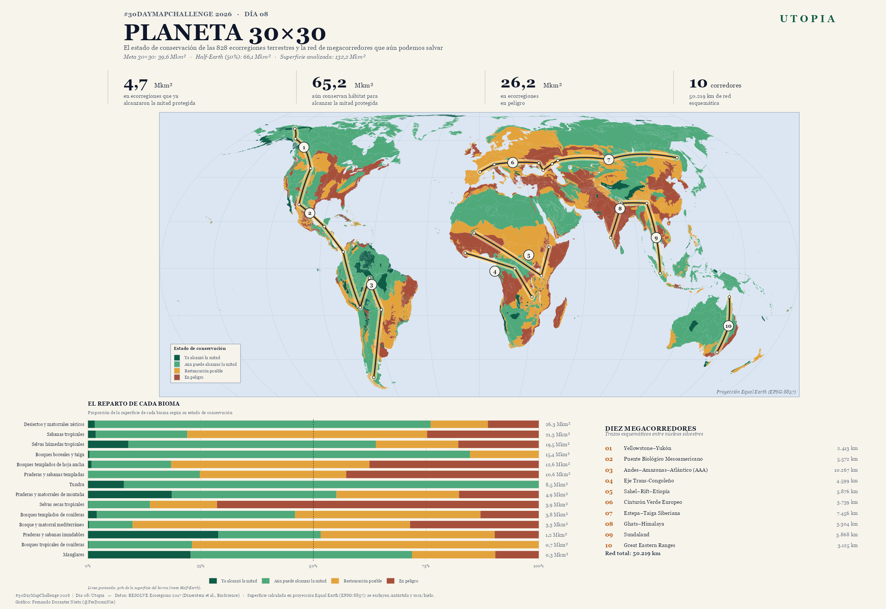
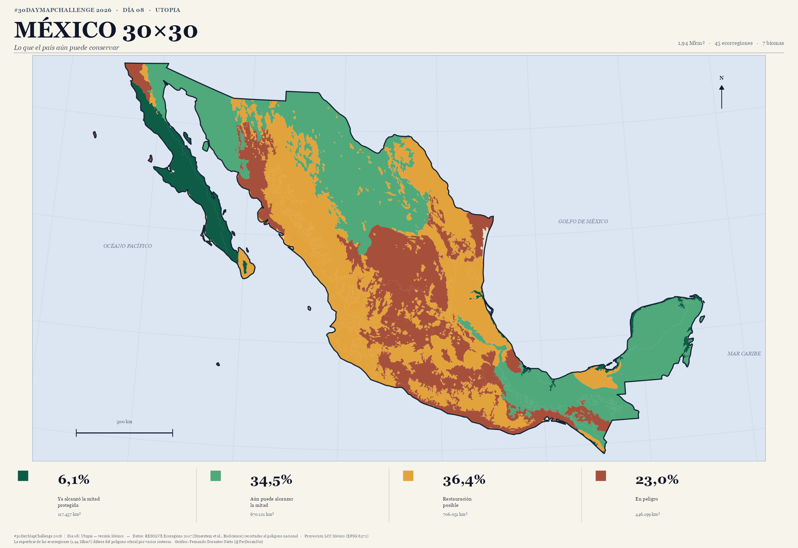

# Día 08 — Utopia (08 de noviembre de 2026)

- **Título:** Planeta 30×30 — Una utopía posible: ecorregiones y megacorredores biológicos
- **Eje temático:** 🌍 Biodiversidad y Problemas Ambientales Mundiales
- **Formato:** 🖼️ Póster estático `.png` (16 × 11 pulgadas, 300 dpi + versión de galería a 150 dpi)
- **Herramientas:** R (`sf`, `ggplot2`, `dplyr`, `patchwork`, `ragg`)
- **Fuente de datos:** RESOLVE Ecoregions 2017 (Dinerstein et al., *BioScience*, 2017) — 846 ecorregiones terrestres y 14 biomas, con la clasificación **NNH** (*Nature Needs Half*) del estado de conservación.

---

## Resumen General

El Marco Mundial de Biodiversidad de Kunming-Montreal fija la meta **30×30**: proteger al menos el 30% de la superficie terrestre y marina para 2030. La visión **Half-Earth** de E. O. Wilson va más lejos y propone la mitad del planeta para la naturaleza. Este mapa no inventa una utopía: cartografía **la utopía científicamente alcanzable** a partir del estado real de conservación de las 846 ecorregiones terrestres.

El resultado es un atlas en tres capas:

1. **El estado de conservación** de cada ecorregión, clasificado por el atributo oficial `NNH_NAME` de Dinerstein et al.: las que ya alcanzaron la mitad protegida, las que aún conservan hábitat suficiente para alcanzarla, las que requieren restauración y las que están en peligro.
2. **El reparto por bioma**, para ver dónde se concentra la oportunidad y dónde la urgencia.
3. **Una red esquemática de 10 megacorredores** que unen los grandes núcleos silvestres de los cinco continentes habitados.

> **Hallazgo central:** el 49.3% de la tierra (65.2 Mkm²) está en ecorregiones que todavía conservan hábitat suficiente para alcanzar la mitad protegida. Esa superficie es **mayor que la meta 30×30** (39.6 Mkm²) y casi equivale a la meta Half-Earth (66.1 Mkm²). La utopía no es un mapa imaginario: es la mitad del planeta que aún no hemos perdido.

---

## Fuentes de Datos

| Fuente | Contenido | Uso en el mapa |
| :--- | :--- | :--- |
| **RESOLVE Ecoregions 2017** (`Ecoregions2017.zip`, Dinerstein et al. 2017) | 846 ecorregiones terrestres, 14 biomas y clasificación NNH | Polígonos, superficies y categorías de conservación |

- URL de descarga: `https://storage.googleapis.com/teow2016/Ecoregions2017.zip` (142 MB)
- Los datos crudos se guardan en `data/raw/day08/` y los procesados en `data/processed/day08_dataset.rds`.

---

## Metodología

El trabajo se divide en dos scripts reproducibles: [`day08_data_pipeline.R`](./day08_data_pipeline.R) y [`day08_poster.R`](./day08_poster.R).

### 1. Limpieza y proyección
Se descartan la fila **"Rock and Ice"** (sin bioma ni reino) y las 18 ecorregiones del reino antártico, y se reparan las geometrías inválidas con `st_make_valid()`. Todo el conjunto se reproyecta a **Equal Earth (EPSG:8857)**, una proyección de áreas equivalentes obligatoria para comparar porcentajes reales de superficie a escala planetaria. El área se calcula con `st_area()`.

**Superficie analizada:** 132.2 millones de km² (828 ecorregiones).

### 2. Clasificación del estado de conservación
Cada ecorregión se asigna a uno de los cuatro niveles oficiales de NNH:

| Categoría NNH | Interpretación | Ecorregiones |
| :--- | :--- | ---: |
| `Half Protected` | Ya alcanzó al menos la mitad protegida | 80 |
| `Nature Could Reach Half Protected` | Conserva hábitat suficiente para llegar a la mitad | 313 |
| `Nature Could Recover` | Requiere restauración ecológica activa | 228 |
| `Nature Imperiled` | En peligro: la pérdida de hábitat compromete su conservación | 207 |

### 3. Cálculo de superficies por bioma
Se suman las áreas de las ecorregiones de cada uno de los 14 biomas y se calcula la composición porcentual por categoría NNH. El gráfico de barras del póster usa proporciones (0–100%) y marca la línea del 50% como referencia *Half-Earth*.

### 4. Red esquemática de megacorredores
Se definieron **32 nodos núcleo** en regiones silvestres de América, África, Eurasia, Asia y Oceanía, y se trazaron **10 corredores** mediante arcos de círculo máximo interpolados y suavizados con el algoritmo de Chaikin. Los nodos intermedios (estepa póntica, estepa del Volga, estepa caspia) guían el trazo por las rutas terrestres que rodean el mar Negro y el Caspio.

> ⚠️ **Nota metodológica:** estos corredores son **trazos esquemáticos** entre núcleos silvestres, no rutas de mínimo costo calculadas sobre una superficie de fricción. El enfoque completo —con *Human Footprint* y algoritmos de *least-cost path*— queda como extensión futura. El mapa es honesto en su título: *una utopía posible*, no un plan de restauración óptimo.

---

## Hallazgos Cuantitativos

### Estado global de las ecorregiones terrestres

| Categoría NNH | Superficie (Mkm²) | % de la tierra | Lectura |
| :--- | ---: | ---: | :--- |
| **Ya alcanzó la mitad protegida** | 4.74 | **3.58%** | El núcleo duro de la conservación mundial |
| **Aún puede alcanzar la mitad** | 65.17 | **49.31%** | La utopía viable: hábitat suficiente para Half-Earth |
| **Restauración posible** | 36.07 | **27.30%** | Tierras que necesitan restauración activa |
| **En peligro** | 26.18 | **19.81%** | Ecorregiones donde la pérdida de hábitat es crítica |
| **Total analizado** | **132.15** | **100%** | Tierras emergidas, sin Antártida ni roca/hielo |

### Los biomas: dónde está la oportunidad y dónde la urgencia

| Bioma | Superficie (Mkm²) | Ya alcanzó | Puede alcanzar | Restauración | En peligro |
| :--- | ---: | ---: | ---: | ---: | ---: |
| Desiertos y matorrales xéricos | 26.3 | 1.5% | 74.5% | 12.7% | 11.3% |
| Sabanas tropicales | 21.3 | 1.7% | 20.3% | 53.2% | 24.8% |
| Selvas húmedas tropicales | 19.5 | 9.0% | 54.9% | 18.3% | 17.9% |
| Bosques boreales y taiga | 15.4 | 0.3% | 84.5% | 15.2% | 0.0% |
| Bosques templados de hoja ancha | 12.6 | 0.8% | 17.7% | 44.0% | 37.6% |
| Tundra | 8.5 | 8.0% | 92.0% | 0.0% | 0.0% |
| Selvas secas tropicales | 3.9 | 0.1% | 13.6% | 14.9% | **71.4%** |
| Manglares | 0.3 | 22.8% | 49.1% | 18.5% | 9.7% |

**Lecturas clave:**

- La **tundra** (92.0%) y los **bosques boreales** (84.5%) son los biomas con mayor proporción de tierra que aún puede alcanzar la mitad protegida: la utopía del norte.
- Las **selvas secas tropicales** son el bioma más amenazado: **71.4%** de su superficie está en ecorregiones en peligro.
- Los **manglares** son uno de los biomas con mayor proporción ya protegida (22.8%), aunque también uno de los más pequeños (0.3 Mkm²).
- Las **selvas húmedas tropicales** concentran la mayor superficie en peligro absoluta (~3.5 Mkm²), a pesar de su alto valor de conservación.

### Los diez megacorredores

| # | Corredor | Longitud (km) | Núcleos |
| :---: | :--- | ---: | :--- |
| 1 | Yellowstone–Yukón | 2,413 | Brooks Range → Yukón → Yellowstone |
| 2 | Puente Biológico Mesoamericano | 5,572 | Yellowstone → Sierra Madre → Selva Maya → Chocó-Darién |
| 3 | Andes–Amazonas–Atlántico (AAA) | 10,267 | Chocó → Andes → Amazonía → Pantanal → Patagonia |
| 4 | Eje Trans-Congoleño | 4,599 | Bosques guineanos → Congo → Miombo |
| 5 | Sahel–Rift–Etiopía | 5,876 | Sahel → Rift oriental → Tierras altas de Etiopía |
| 6 | Cinturón Verde Europeo | 3,739 | Pirineos → Alpes → Cárpatos → Estepa póntica → Cáucaso |
| 7 | Estepa–Taiga Siberiana | 7,456 | Cáucaso → Estepa del Volga → Estepa caspia → Altái → Amur |
| 8 | Ghats–Himalaya | 3,304 | Ghats occidentales → Himalaya → Suroeste de China |
| 9 | Sundaland | 3,868 | Suroeste de China → Sundaland |
| 10 | Great Eastern Ranges | 3,125 | Cabo York → Gran Cordillera Divisoria → Alpes australianos |
| | **Red total** | **50,219** | **32 nodos núcleo** |

---

## Estructura del Póster

- **Cabecera:** título *Planeta 30×30*, subtítulo y las metas de referencia (30×30, Half-Earth y superficie analizada).
- **Franja de indicadores:** 4.7 Mkm² ya medio protegidos · 65.2 Mkm² aún pueden alcanzar la mitad · 26.2 Mkm² en peligro · 10 corredores y 50,219 km de red.
- **Mapa principal:** las 828 ecorregiones coloreadas por categoría NNH en Equal Earth, con la red de megacorredores (halo cálido + núcleo oscuro) y los 10 corredores numerados.
- **Panel inferior izquierdo:** barras normalizadas por bioma con la línea del 50% (*Half-Earth*) y la superficie total de cada bioma.
- **Panel inferior derecho:** índice de los diez megacorredores con su longitud.

**Paleta (Estilo Atlas Enmarcado):** papel crema `#F7F4EB`, océano azul atlas `#DCE6F2`, marco `#94A3B8`, retícula `#B8C7D9`; categorías en esmeralda profundo `#0E5C46`, jade `#4FA97B`, ámbar `#E3A33C` y terracota `#A6503C`.

---

## Archivos Generados

- **Scripts:** [`day08_data_pipeline.R`](./day08_data_pipeline.R) · [`day08_poster.R`](./day08_poster.R) · [`day08_mexico_pipeline.R`](./day08_mexico_pipeline.R) · [`day08_poster_mexico.R`](./day08_poster_mexico.R)
- **Datos procesados:**
  - `data/processed/day08_dataset.rds` (ecorregiones, barras, corredores, KPIs)
  - `data/processed/day08_mexico.rds` (recorte nacional)
  - `data/processed/day08_resumen_nnh.csv`
  - `data/processed/day08_corredores.csv`
- **Imágenes:**
  - `outputs/high_res/day08_utopia_planeta_30x30.png` (4800 × 3300 px, 300 dpi)
  - `outputs/gallery/day08_utopia_planeta_30x30.png` (2400 × 1650 px, 150 dpi)
  - `outputs/high_res/day08_utopia_mexico.png` (4800 × 3300 px, 300 dpi)
  - `outputs/gallery/day08_utopia_mexico.png` (2400 × 1650 px, 150 dpi)

## Vista Previa

---

## Versión Alterna: México

Además del mapa global se construyó una **versión nacional** que recorta las ecorregiones al polígono de México y las proyecta en **LCC México (EPSG:6372)** para calcular superficies exactas.

**Resultados para México (1.94 Mkm², 45 ecorregiones, 7 biomas):**

| Categoría NNH | Superficie (km²) | % del territorio |
| :--- | ---: | ---: |
| Ya alcanzó la mitad protegida | 117,457 | 6.1% |
| Aún puede alcanzar la mitad | 670,121 | 34.5% |
| Restauración posible | 706,051 | 36.4% |
| En peligro | 446,199 | 23.0% |

México es, sobre todo, un país de **restauración**: más de un tercio de su superficie está en ecorregiones que necesitan rehabilitación activa, y solo 6.1% en ecorregiones que ya alcanzaron la mitad protegida. Los núcleos mejor conservados son el desierto de Baja California, los matorrales xéricos del Golfo de California y los manglares del sur; las mayores oportunidades están en el desierto de Chihuahua y las selvas húmedas del sureste.

**Scripts:** [`day08_mexico_pipeline.R`](./day08_mexico_pipeline.R) y [`day08_poster_mexico.R`](./day08_poster_mexico.R)
**Salidas:** `outputs/high_res/day08_utopia_mexico.png` y `outputs/gallery/day08_utopia_mexico.png`

---

*Pie de figura: #30DayMapChallenge 2026 | Día 08: Utopia — Datos: RESOLVE Ecoregions 2017 (Dinerstein et al.) | Gráfico: Fernando Dorantes Nieto (@FerDoranNie)*
