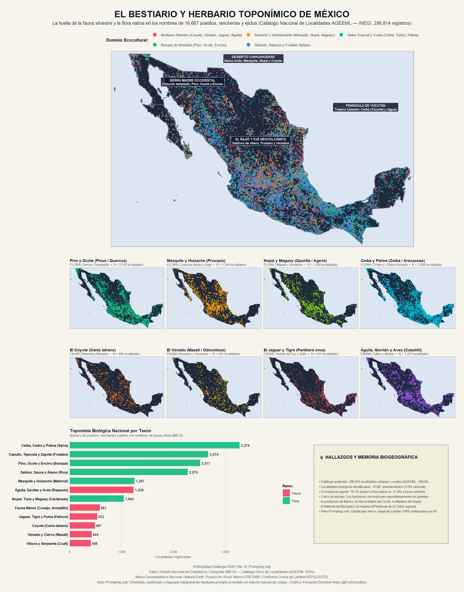
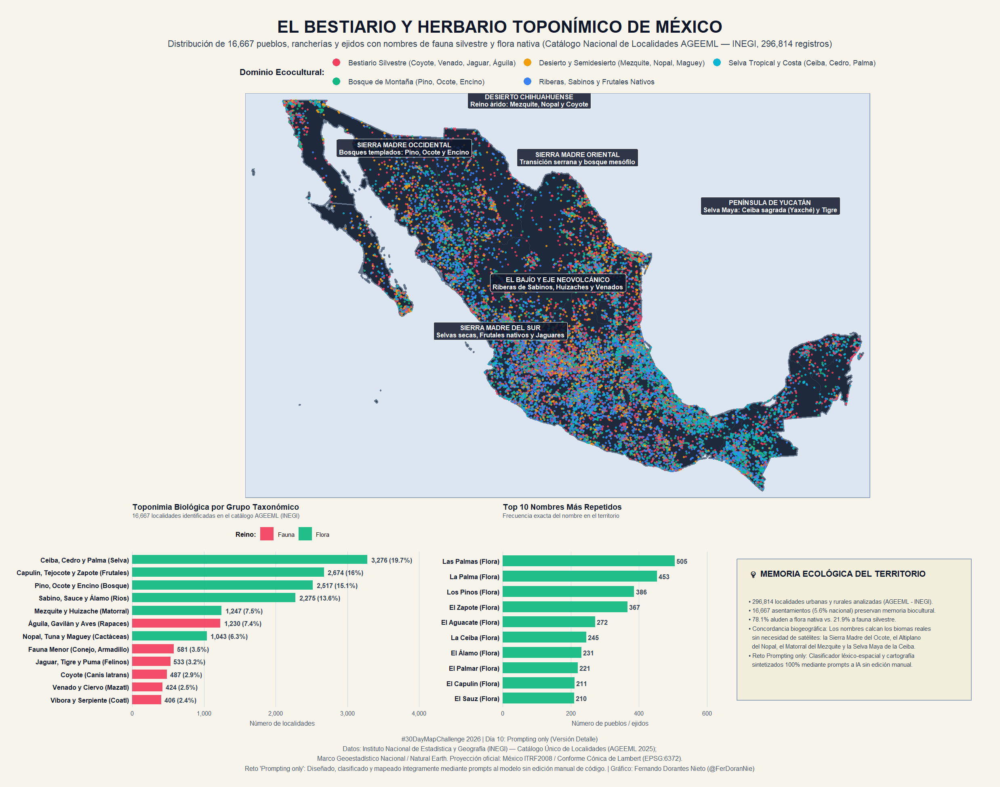

# Día 10 — Prompting only: El Bestiario y Herbario Toponímico de México

- **Título oficial:** El Bestiario y Herbario Toponímico de México: Geografía de la fauna y flora en los nombres de ~300,000 localidades
- **Eje temático:** 💡 Datos Curiosos y Exploraciones Creativas / 🇲🇽 México
- **Formato de salida:** 🖼️ Póster cartográfico editorial en alta resolución (`300 dpi`) y versión web (`150 dpi`).
- **Estado:** ✅ **Completado y Publicado** (10 de noviembre de 2026).
- **Herramientas:** R (`sf`, `dplyr`, `stringr`, `stringi`, `readr`, `ggplot2`, `patchwork`, `scales`), **generado íntegramente mediante prompting al modelo sin edición manual de código**.
- **Fuentes de datos:**
  1. **Catálogo Único de Localidades (AGEEML - INEGI):** 296,814 localidades georreferenciadas (urbanas y rurales) con coordenadas decimales (`LAT_DEC`, `LON_DEC`) y nombre oficial (`NOM_LOC`).
  2. **Marco Geoestadístico Nacional (INEGI / Natural Earth):** Límites estatales y costa oficial de México en proyección Cónica Conforme de Lambert (`EPSG:6372`).

---

## 🖼️ Póster Final

### Versión 1: Atlas Completo con Pequeños Múltiplos

### Versión 2: Gran Mapa General Ampliado + Desglose de Barras

---

## 🎯 Concepto y Narrativa Biogeográfica

La memoria ecológica de un país queda grabada en los nombres de sus pueblos, rancherías, parajes y ejidos. Mucho antes de que existieran satélites o inventarios florísticos y faunísticos modernos, los habitantes originarios y mestizos nombraron su territorio en español y en lenguas indígenas (náhuatl, maya, purépecha, zapoteco, rarámuri) a partir de los animales y árboles que dominaban cada paisaje.

Al aplicar un clasificador léxico-espacial con límites de palabra (`\b`) sobre las **296,814 localidades oficiales del INEGI**, se identificaron **16,667 asentamientos (5.6% del total nacional)** cuyos nombres provienen de taxones biológicos nativos.

Al proyectarlos sobre el mapa nacional, los topónimos **calcan espontáneamente los biomas reales de México**:
1. **Pino, Ocote y Encino (2,517 localidades):** Delinean con precisión milimétrica las crestas de la **Sierra Madre Occidental**, la **Sierra Madre Oriental**, el **Eje Neovolcánico** y la **Sierra Madre del Sur**.
2. **Mezquite, Huizache, Nopal y Maguey (2,290 localidades):** Trazan el corazón del **Altiplano Semiárido**, el **Desierto Chihuahuense**, el **Desierto Sonorense** y la cuenca del **Bajío**.
3. **Ceiba, Cedro, Palma y Zapote (5,950 localidades):** Marcan las tierras bajas tropicales cálido-húmedas del **Golfo de México**, la **Huasteca**, **Chiapas** y la **Península de Yucatán** (donde la Ceiba o *Yaxché* fue el árbol sagrado de la cosmogonía maya).
4. **Sabino, Sauce y Álamo (2,275 localidades):** Siguen las riberas fluviales históricas y manantiales (bosque de galería y humedales lacustres de la Cuenca Lerma-Santiago).
5. **Bestiario Silvestre (3,661 localidades):**
   - **El Coyote (*Canis latrans*, 487 locs):** Concentrado en las planicies y mesetas áridas del norte y centro.
   - **El Venado (*Mazatl* / *Odocoileus*, 424 locs):** Distribuido en laderas templadas y serranías de caza histórica.
   - **El Jaguar, Tigre y Puma (*Panthera onca*, 533 locs):** Fiel reflejo de las selvas del sureste, la costa del Pacífico sur y las serranías aisladas donde históricamente acechaba el felino ("El Tigre").
   - **Águila, Gavilán y Aves (*Cuauhtli*, 1,230 locs):** Repartidas en cañadas y peñascos a lo largo de las grandes cadenas montañosas.

---

## 📊 Síntesis de Resultados por Taxón

| Reino | Grupo Taxonómico | Especies / Raíces Representativas | Localidades | Ejemplos del Catálogo INEGI |
| :---: | :--- | :--- | :---: | :--- |
| **Flora** | Selva Húmeda y Palma | Ceiba (*Ceiba pentandra*), Cedro, Palma, Yaxché | **3,276** | *La Palma*, *El Ceibal*, *Cedral*, *El Palmar* |
| **Flora** | Frutales y Nativos | Capulín, Tejocote, Guamúchil, Zapote, Ciruelo | **2,674** | *El Zapote*, *El Capulín*, *El Guayabo*, *El Tejocote* |
| **Flora** | Bosque Templado | Ocote (*Pinus*), Pino, Oyamel, Encino (*Quercus*) | **2,517** | *El Ocote*, *Los Pinos*, *Los Encinos*, *El Pinal* |
| **Flora** | Ríos y Riberas | Sabino (*Taxodium*), Sauce (*Salix*), Álamo | **2,275** | *El Sabino*, *El Sauz*, *Los Álamos*, *Ojo de Agua de los Sauces* |
| **Flora** | Matorral Árido | Mezquite (*Prosopis*), Huizache (*Vachellia*) | **1,247** | *El Mezquite*, *El Huizachal*, *La Huizachera*, *Mezquitillos* |
| **Flora** | Cactáceas y Xerófilas | Nopal (*Opuntia*), Tuna, Maguey (*Agave*), Cardón | **1,043** | *El Cardón*, *El Maguey*, *Las Biznagas*, *La Nopalera* |
| **Fauna** | Águila, Gavilán y Aves | Águila (*Aquila*), Gavilán, Halcón, Cuauhtli | **1,230** | *El Águila*, *Las Aguilillas*, *Los Gavilanes*, *Los Halcones* |
| **Fauna** | Fauna Menor | Armadillo, Conejo, Tlacuache, Liebre, Zorrillo | **581** | *El Conejo*, *Las Conejeras*, *El Zorrillo*, *Las Liebres* |
| **Fauna** | Jaguar, Tigre y Puma | Jaguar (*Panthera onca*), Tigre, Puma, Balam | **533** | *El Tigre*, *Los Leones*, *K-An-Tum-Balam*, *Arroyo León* |
| **Fauna** | Coyote | Coyote (*Canis latrans*), Coyotera, Coyotlán | **487** | *El Coyote*, *Los Coyotes*, *La Coyotera*, *Los Coyotillos* |
| **Fauna** | Venado y Ciervo | Venado (*Odocoileus*), Venadito, Mazatlán | **424** | *El Venado*, *Los Venados*, *El Venadito*, *El Venadero* |
| **Fauna** | Víbora y Serpiente | Víbora (*Crotalus*), Culebra, Cascabel, Coatl | **406** | *Las Víboras*, *Los Cascabeles*, *Viborillas*, *Coatlán* |
| **TOTAL** | **12 Grupos Emblemáticos** | **78.1% Flora vs. 21.9% Fauna** | **16,667** | **5.6% del Catálogo Nacional de Localidades** |

---

## 🛠️ Reproducibilidad y Código

1. **Pipeline de Datos (`day10_data_pipeline.R`):**
   - Descarga y parsea el CSV oficial de INEGI (`AGEEML_20251141548499.csv`).
   - Normaliza caracteres (`stringi::stri_trans_general("Latin-ASCII")`).
   - Aplica filtros de exclusión estricta de antropónimos (evitando falsos positivos como apellidos *León*, héroes de la patria *Zapata / Pino Suárez* o estados *Nuevo León*).
   - Clasifica y proyecta en `EPSG:6372` (México ITRF2008 / Conforme Cónica de Lambert).
   - Genera `data/processed/day10_toponimos_biologicos.rds`.

2. **Póster Cartográfico (`day10_poster.R`):**
   - Aplica el **Estilo Atlas Enmarcado** (`utils/theme_map2026.R`): Lienzo crema `#F7F4EB`, océano `#DCE6F2`, marco `#94A3B8`, polígonos continentales en azul pizarra `#1E293B` con divisiones `#334155`.
   - **Panel A:** Mapa nacional con los 5 grandes dominios ecoculturales y llamadas biogeográficas enmarcadas.
   - **Panel B:** Cuadrícula de pequeños múltiplos con 8 mini-mapas de México (4 Flora vs 4 Fauna) ilustrando la huella espacial de cada taxón.
   - **Panel C:** Gráfico de barras clasificado por reino y tarjeta de síntesis y hallazgos.

---

## 📦 Entregables

- **Versión 1 (Atlas Editorial con Múltiplos):**
  - Alta Resolución (300 dpi): [`outputs/high_res/day10_prompting_only_toponimos.png`](../../outputs/high_res/day10_prompting_only_toponimos.png)
  - Galería Web (150 dpi): [`outputs/gallery/day10_prompting_only_toponimos.png`](../../outputs/gallery/day10_prompting_only_toponimos.png)
- **Versión 2 (Gran Mapa Detallado + Barras):**
  - Alta Resolución (300 dpi): [`outputs/high_res/day10_prompting_only_detalle.png`](../../outputs/high_res/day10_prompting_only_detalle.png)
  - Galería Web (150 dpi): [`outputs/gallery/day10_prompting_only_detalle.png`](../../outputs/gallery/day10_prompting_only_detalle.png)
- **Dataset Procesado:** `data/processed/day10_toponimos_biologicos.rds`
- **Firma Oficial:** `#30DayMapChallenge 2026 | Día 10: Prompting only — Datos: Catálogo Único de Localidades (AGEEML - INEGI) | Gráfico: Fernando Dorantes Nieto (@FerDoranNie)`.
