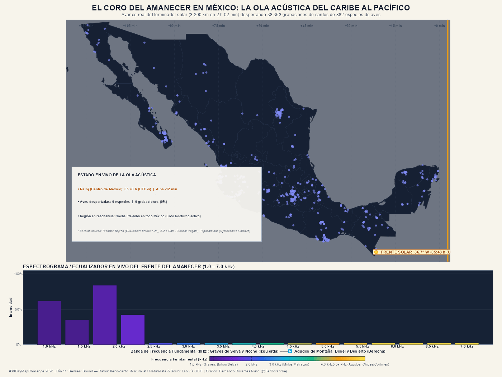
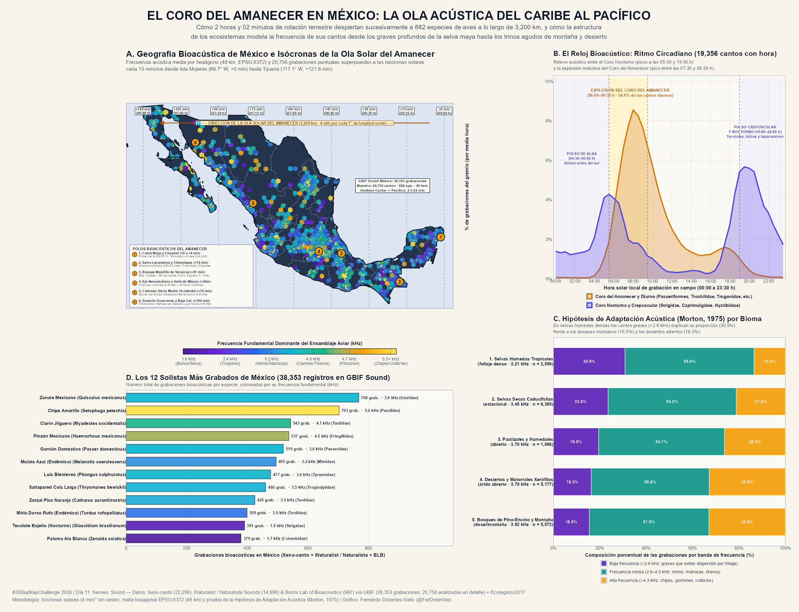

# Día 11 — Senses: Sound (11 de noviembre de 2026)

- **Título:** El coro del amanecer en México: La ola acústica de las aves del Caribe al Pacífico
- **Eje temático:** 🦜 Información sobre Aves
- **Formato de salida:** 🎬 **Animación `.mp4` y `.gif`** (la ola solar del amanecer + ondas acústicas concéntricas y espectrograma en vivo) + 🖼️ **Póster estático `.png`** (mapa de paisaje sonoro, ritmos circadianos y frecuencias a 300 dpi).
- **Estado:** ✅ **Completado y Publicado** (11 de noviembre de 2026).
- **Herramientas:** R 4.3.2 (`sf`, `terra`, `ggplot2`, `patchwork`, `dplyr`, `tidyr`, `httr`, `curl`, `jsonlite`, `ragg`, `gifski`, `av`).
- **Fuentes de datos:**
  1. **GBIF Bird Sound Multimedia Occurrences (`mediaType = Sound`, `taxonKey = 212`, `country = MX`):** **38,353 grabaciones bioacústicas georreferenciadas** en México correspondientes a **882 especies** de aves, integrando las colecciones de **Xeno-canto** (22,299 grabaciones), **iNaturalist / Naturalista Sounds** (14,998 grabaciones), **Borror Lab of Bioacoustics — Ohio State University** (987 grabaciones) y **MVZ / Observation.org** (69 grabaciones).
  2. **Muestra detallada analizada:** **20,756 grabaciones individuales** en territorio continental e insular de México (**19,356 con hora local exacta `eventTime`**) pertenecientes a **778 especies** y **86 familias** aviares.
  3. **Ecorregiones y Biomas de México (`RESOLVE Ecoregions2017` / CONABIO / INEGI):** Cruce espacial en proyección Cónica Conforme de Lambert (`EPSG:6372`) para evaluar cuantitativamente la **Hipótesis de Adaptación Acústica** (Morton, 1975).

---

## 🎬 Animación: La Ola Acústica del Amanecer (05:48 a 08:12 h UTC-6)



- 🎥 **Versión en video MP4:** [`outputs/gallery/day11_senses_sound_amanecer.mp4`](../../outputs/gallery/day11_senses_sound_amanecer.mp4)

---

## 🖼️ Póster Cartográfico Editorial



---

## 🎯 Concepto y Marco Bioacústico (*Senses: Sound*)

¿Cómo se **escucha** la geografía de México cuando sale el sol?
Cada mañana, conforme el terminador solar recorre los **3,200 km** que separan Isla Mujeres (Quintana Roo, $86.7^\circ\text{ W}$) de Tijuana (Baja California, $117.1^\circ\text{ W}$), la rotación terrestre ($15^\circ/\text{h}$, equivalente a **$4.0\text{ minutos}$ por cada grado de longitud oeste**) tarda exactamente **2 horas con 02 minutos ($121.6\text{ minutos}$)** en encender sucesivamente el coro aviar desde el Mar Caribe hasta el Océano Pacífico.

A su vez, la estructura física de la vegetación filtra y modela las frecuencias del paisaje sonoro de acuerdo con la **Hipótesis de Adaptación Acústica (Morton, 1975; Ryan & Brenowitz, 1985; Boncoraglio & Saino, 2007)**:
- **Selvas húmedas cerradas y coro nocturno ($0.9\text{–}2.6\text{ kHz}$):** Las ondas sonoras de longitud larga rodean troncos y follaje denso con mínima atenuación por dispersión. Predominan graves profundos y tonos puros de tinamúes (`Tinamidae`), hocofaisanes y chachalacas (`Cracidae`), palomas (`Columbidae`), trogones (`Trogonidae`), momotos (`Momotidae`) y búhos (`Strigidae`).
- **Bosques templados, cañadas y bordes ($2.6\text{–}4.3\text{ kHz}$):** Dominan vocalizaciones moduladas y armónicas de mirlos y clarines (`Turdidae`), matracas y saltaparedes (`Troglodytidae`), cuitlacoches y mulatos (`Mimidae`) y mosqueros (`Tyrannidae`).
- **Dosel montano, pastizales y desiertos abiertos ($4.3\text{–}7.5\text{ kHz}$):** En ambientes abiertos o en las copas de los árboles —donde la turbulencia atmosférica y el viento dominan sobre la reverberación vegetal— prevalecen trinos rápidos de alta frecuencia emitidos por chipes (`Parulidae`), gorriones (`Passerellidae`), pinzones (`Fringillidae`) y colibríes (`Trochilidae`).

---

## 📊 Hallazgos Principales

### 1. Prueba Cuantitativa de la Hipótesis de Adaptación Acústica por Bioma
Al cruzar las **20,756 grabaciones** con los 5 grandes macro-biomas de México (`Ecoregions2017`), se confirma un desplazamiento sistemático de la frecuencia acústica dominante desde las selvas perennifolias cerradas hacia los ecosistemas abiertos y de montaña:

| Macro-Bioma de México | Grabaciones Analizadas | Especies | Familias | Frecuencia Media (kHz) | Mediana (IQR, kHz) | % Baja Frecuencia ($<2.6\text{ kHz}$) | % Media ($2.6\text{–}4.3\text{ kHz}$) | % Alta Frecuencia ($>4.3\text{ kHz}$) |
| :--- | ---: | ---: | ---: | ---: | :---: | ---: | ---: | ---: |
| **1. Selvas Húmedas Tropicales** | 2,556 | 355 | 56 | **3.21 kHz** | 3.34 (2.35–3.76) | **30.9 %** | 55.6 % | 13.5 % |
| **2. Selvas Secas Caducifolias** | 6,365 | 435 | 72 | **3.45 kHz** | 3.52 (2.66–4.08) | **23.6 %** | 55.2 % | 21.2 % |
| **3. Pastizales, Humedales y Manglares** | 1,086 | 229 | 52 | **3.70 kHz** | 3.60 (3.15–4.53) | **19.5 %** | 54.1 % | 26.3 % |
| **4. Desiertos y Matorrales Xerófilos** | 5,177 | 350 | 59 | **3.79 kHz** | 3.58 (3.34–4.57) | **16.3 %** | 50.8 % | **32.9 %** |
| **5. Bosques de Pino-Encino y Montaña** | 5,572 | 445 | 60 | **3.92 kHz** | 3.72 (3.17–4.62) | **15.5 %** | 51.5 % | **33.0 %** |

- En las **Selvas Húmedas Tropicales** (Lacandona, Los Chimalapas, Uxpanapa y Selva Maya), casi **una de cada tres grabaciones (30.9 %)** pertenece a la banda grave ($<2.6\text{ kHz}$), el doble que en los bosques de pino-encino (15.5 %) y los desiertos xerófilos (16.3 %).
- En contraste, los cantos agudos ($>4.3\text{ kHz}$) pasan de apenas **13.5 %** en la selva húmeda a **32.9 %–33.0 %** en los desiertos del norte y los bosques montanos.

### 2. El Reloj Circadiano: Relevo entre el Coro Nocturno y el Coro del Amanecer
El análisis de las **19,356 grabaciones con marca horaria exacta (`eventTime`)** revela la partición temporal del espacio acústico mexicano:
- **Pulso de Alba del Coro Nocturno (`04:30–06:00 h`):** Alcanza el **12.7 %** de las vocalizaciones nocturnas justo antes de la salida del sol (despedida de tecolotes y tapacaminos).
- **Explosión del Coro del Amanecer (`06:00–09:30 h`):** Concentra el **54.8 % de todas las grabaciones diurnas del país** en una ventana de apenas 3.5 horas, alcanzando su máximo absoluto entre las **07:30 y las 08:30 h** (17.9 % del total diario en una sola hora).
- **Pulso Crepuscular Vespertino (`19:00–21:00 h`):** Al caer la noche, el gremio nocturno (`Strigidae`, `Caprimulgidae`, `Nyctibiidae`) retoma el canal acústico con el **22.6 %** de su actividad diaria concentrada entre las 19:00 y las 20:30 h.

### 3. Los 12 Solistas Más Grabados de México (38,353 registros en GBIF Sound)

| Rango | Especie | Nombre Común | Familia | Grabaciones en México | Frecuencia Dominante (kHz) | Gremio Horario |
| :---: | :--- | :--- | :--- | ---: | :---: | :--- |
| **1** | *Quiscalus mexicanus* | Zanate Mexicano | `Icteridae` | **768** | 3.58 kHz | Coro del Amanecer y Diurno |
| **2** | *Setophaga petechia* | Chipe Amarillo | `Parulidae` | **703** | 5.58 kHz | Coro del Amanecer y Diurno |
| **3** | *Myadestes occidentalis* | Clarín Jilguero | `Turdidae` | **543** | 4.10 kHz | Coro del Amanecer y Diurno |
| **4** | *Haemorhous mexicanus* | Pinzón Mexicano | `Fringillidae` | **537** | 4.54 kHz | Coro del Amanecer y Diurno |
| **5** | *Passer domesticus* | Gorrión Doméstico | `Passeridae` | **519** | 3.56 kHz | Coro del Amanecer y Diurno |
| **6** | *Melanotis caerulescens* | Mulato Azul *(Endémico)* | `Mimidae` | **495** | 3.23 kHz | Coro del Amanecer y Diurno |
| **7** | *Pitangus sulphuratus* | Luis Bienteveo | `Tyrannidae` | **477** | 3.60 kHz | Coro del Amanecer y Diurno |
| **8** | *Thryomanes bewickii* | Saltapared Cola Larga | `Troglodytidae` | **460** | 3.52 kHz | Coro del Amanecer y Diurno |
| **9** | *Catharus aurantiirostris* | Zorzal Pico Naranja | `Turdidae` | **425** | 3.46 kHz | Coro del Amanecer y Diurno |
| **10** | *Turdus rufopalliatus* | Mirlo Dorso Rufo *(Endémico)* | `Turdidae` | **399** | 3.00 kHz | Coro del Amanecer y Diurno |
| **11** | *Glaucidium brasilianum* | Tecolote Bajeño | `Strigidae` | **391** | 1.86 kHz | Coro Nocturno y Crepuscular |
| **12** | *Zenaida asiatica* | Paloma Ala Blanca | `Columbidae` | **379** | 1.68 kHz | Coro del Amanecer Temprano |

---

## 📂 Estructura de Archivos y Reproducibilidad

```powershell
# 1. Descarga de grabaciones GBIF Sound y procesamiento bioacústico
& "C:\Program Files\R\R-4.3.2\bin\Rscript.exe" days/day11_senses_sound/day11_data_pipeline.R

# 2. Generación del póster estático (300 dpi y 150 dpi)
& "C:\Program Files\R\R-4.3.2\bin\Rscript.exe" days/day11_senses_sound/day11_poster.R

# 3. Generación de la animación de la ola del amanecer (.gif y .mp4)
& "C:\Program Files\R\R-4.3.2\bin\Rscript.exe" days/day11_senses_sound/day11_animate.R
```

- **Scripts:** [`day11_data_pipeline.R`](./day11_data_pipeline.R), [`day11_poster.R`](./day11_poster.R) y [`day11_animate.R`](./day11_animate.R).
- **Datos procesados:** `data/processed/day11_soundscape_mexico.rds` y caché crudo `data/raw/day11/gbif_sound_occurrences_mx.rds`.
- **Entregables gráficos:**
  - `outputs/high_res/day11_senses_sound_coro_amanecer.png` (300 dpi) y `outputs/gallery/day11_senses_sound_coro_amanecer.png` (150 dpi)
  - `outputs/gallery/day11_senses_sound_amanecer.gif` y `outputs/gallery/day11_senses_sound_amanecer.mp4`
  - **Subgráficas individuales extras (300 dpi en `outputs/high_res/` y 150 dpi en `outputs/gallery/`):**
    - `day11_panelA_mapa_bioacustico.png` — Mapa nacional e isócronas del amanecer
    - `day11_panelB_reloj_circadiano.png` — Ritmo circadiano (Coro del Amanecer vs. Coro Nocturno)
    - `day11_panelC_hipotesis_morton.png` — Prueba de la Hipótesis de Adaptación Acústica por bioma
    - `day11_panelD_top12_solistas.png` — Los 12 solistas más grabados de México
- **Pie de figura oficial (`caption`):** `#30DayMapChallenge 2026 | Día 11: Senses: Sound — Datos: Xeno-canto & Macaulay Library / iNaturalist vía GBIF | Gráfico: Fernando Dorantes Nieto (@FerDoranNie)`.
