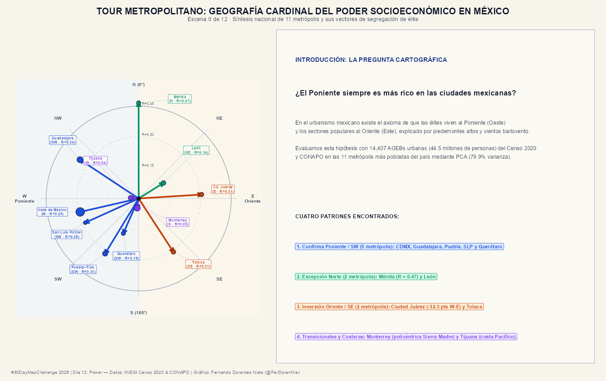
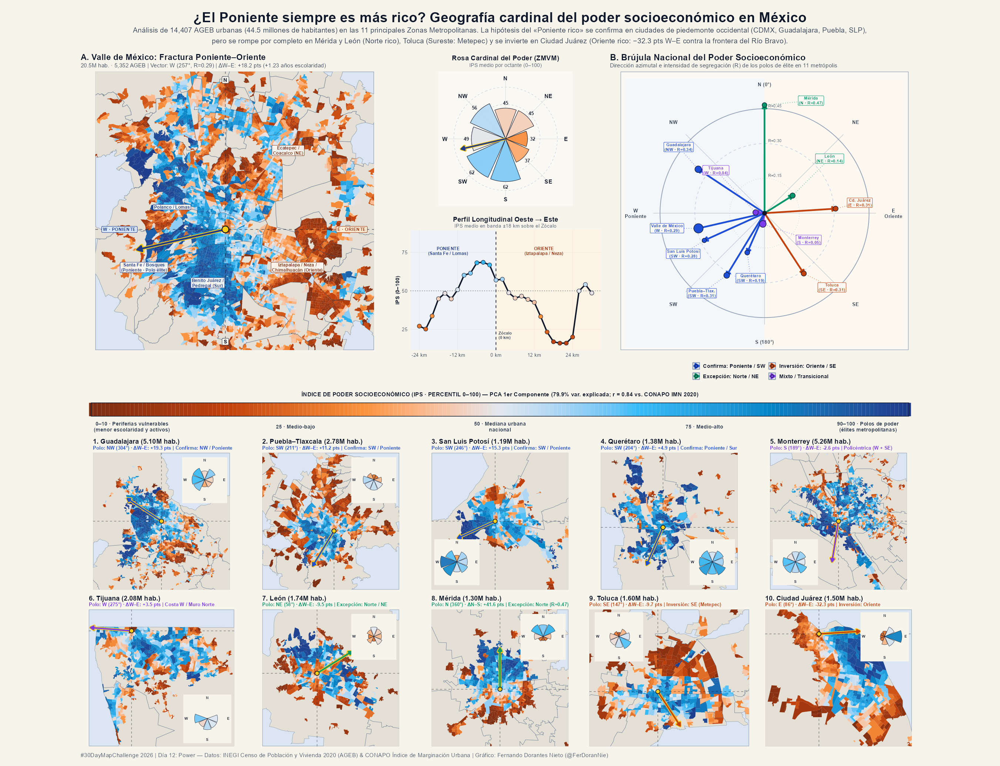

# Día 12 — Power (12 de noviembre de 2026)

- **Título:** ¿El Poniente siempre es más rico? Geografía cardinal del poder y la desigualdad socioeconómica en las metrópolis de México
- **Eje temático:** 🇲🇽 México (Demografía, Sociedad y Medio Ambiente)
- **Formato de salida:** 🎬 **Animación `.mp4` y `.gif`** (tour metropolitano escena a escena de las 11 ciudades) + 🖼️ **Póster estático analítico `.png`** (300 dpi alta resolución y 150 dpi galería).
- **Estado:** ✅ **Completado y Publicado** (12 de noviembre de 2026).
- **Herramientas:** R 4.3.2 (`sf`, `dplyr`, `tidyr`, `ggplot2`, `patchwork`, `scales`, `ragg`, `gifski`, `av`, `data.table`, `readxl`).
- **Fuentes de datos (100 % oficiales):**
  1. **INEGI — Censo de Población y Vivienda 2020 por AGEB Urbana (`cpv2020`):** Indicadores censales de escolaridad promedio (`GRAPROES`), viviendas particulares habitadas (`TVIVPARHAB`), disponibilidad de automóvil (`VPH_AUTOM`), computadora (`VPH_PC`), internet (`VPH_INTER`) y 3 o más cuartos (`VPH_3YMASC`) en **14,407 AGEB urbanas válidas** (**44.5 millones de habitantes**) distribuidas en **11 Zonas Metropolitanas**.
  2. **CONAPO — Índice de Marginación Urbana por AGEB 2020 (`IMU_2020`):** Validación externa del Índice de Poder Socioeconómico (`r = 0.837` respecto a `IMN_2020`).
  3. **INEGI — Marco Geoestadístico Nacional 2020:** Polígonos oficiales de AGEB urbanas (`{ent}a.shp`) y límites municipales (`{ent}mun.shp`) proyectados en `EPSG:6372` (`MEXICO_ITRF_2008_LCC`).

---

## 🎬 Animación: Tour Metropolitano Escena a Escena (13 Escenas)



- 🎥 **Versión en video HD MP4:** [`outputs/gallery/day12_power_ciudades_tour.mp4`](../../outputs/gallery/day12_power_ciudades_tour.mp4)

---

## 🖼️ Póster Cartográfico Editorial



---

## 🎯 Concepto, Índice `IPS` y Metodología Cardinal

Para evaluar empíricamente la hipótesis urbana del **"Poniente rico y Oriente pobre"** en las grandes ciudades mexicanas:

1. **Índice de Poder Socioeconómico (`IPS`, percentil 0–100):** Se extrajo el primer componente principal (`PCA`) de cinco variables censales a nivel AGEB (`GRAPROES`, `% automóvil`, `% computadora`, `% internet` y `% viviendas ≥3 cuartos`), capturando el **79.9 % de la varianza total** (con correlación `r = 0.837` frente al `IMN_2020` de CONAPO).
2. **Geometría Cardinal Respecto al Centro Histórico (`EPSG:6372`):** Para cada AGEB (`dist_km >= 0.5 km`) se calculó su distancia y ángulo acimutal $\theta \in [0^\circ, 360^\circ)$ respecto a la plaza fundacional de su metrópoli, agrupando los datos en 8 octantes (`N, NE, E, SE, S, SW, W, NW`).
3. **Vector Resultante de Poder Socioeconómico ($\theta_{\text{vec}}, R$):** Ponderado por población y exceso local de `IPS`, donde $\theta_{\text{vec}}$ señala el rumbo cardinal de concentración de las élites y $R \in [0, 1]$ mide la intensidad de segregación direccional.

---

## 📊 Resultados Empíricos en las 11 Zonas Metropolitanas (44.4M hab. en `dist >= 0.5 km`)

| Zona Metropolitana | Población Analizada | AGEB Válidas | Vector Resultante ($\theta$, $R$) | Octante Más Rico (`IPS`) | Octante Más Vulnerable (`IPS`) | Brecha $\Delta_{W - E}$ (`IPS` / `GRAPROES`) | Brecha $\Delta_{N - S}$ (`IPS`) | Veredicto Empírico |
| :--- | ---: | ---: | :---: | :---: | :---: | :---: | :---: | :--- |
| **Valle de México** | 20,491,840 | 5,352 | **W (257° · R = 0.29)** | S (62.0) / SW (61.5) | E (31.9) | **+18.2 pts** (+1.23 años) | −2.2 pts | ✅ **Confirma: Poniente / SW** |
| **Monterrey** | 5,260,963 | 2,035 | **S (189° · R = 0.05)** | W (66.0) / SE (65.4) | NW (48.6) | −2.6 pts (+0.00 años) | −9.6 pts | ⛰️ **Policéntrica (W + SE Sierra Madre)** |
| **Guadalajara** | 5,101,185 | 1,882 | **NW (304° · R = 0.34)** | NW (67.5) / W (66.8) | S (37.6) | **+19.3 pts** (+1.68 años) | +12.8 pts | ✅ **Confirma: NW / Poniente** |
| **Puebla–Tlaxcala** | 2,784,037 | 877 | **SW (211° · R = 0.31)** | W (56.8) / S (54.3) | NE (25.8) | **+11.2 pts** (+0.84 años) | −21.2 pts | ✅ **Confirma: SW / Poniente** |
| **Tijuana** | 2,083,458 | 809 | **W (275° · R = 0.04)** | W (63.2) | NE (2.0) / SW (46.2) | +3.5 pts (+0.14 años) | −50.2 pts | 🌊 **Costa W / Truncada al Norte** |
| **León** | 1,742,390 | 649 | **NE (58° · R = 0.14)** | N (50.0) | S (25.4) / W (29.1) | **−9.6 pts** (−0.55 años) | +0.9 pts | 🔄 **Excepción: Norte / NE** |
| **Toluca** | 1,602,931 | 484 | **SE (147° · R = 0.31)** | SE (65.5) | N (20.3) | **−9.7 pts** (−0.61 años) | −25.1 pts | 🔄 **Inversión: Sureste (Metepec)** |
| **Ciudad Juárez** | 1,501,052 | 576 | **E (86° · R = 0.31)** | E (84.4) | W (21.4) | **−32.3 pts** (−2.07 años) | −25.1 pts | 🔄 **Inversión Total: Oriente (Río Bravo)** |
| **Querétaro** | 1,377,510 | 577 | **SW (204° · R = 0.19)** | SW (76.2) / SE (75.5) | N (51.7) | +4.9 pts (−0.04 años) | −11.0 pts | ✅ **Poniente / Sur** |
| **Mérida** | 1,297,071 | 689 | **N (360° · R = 0.47)** | NE (69.6) / NW (68.4) | S (21.6) | +1.4 pts (+0.22 años) | **+41.6 pts** | 🔄 **Excepción Máxima: Norte** |
| **San Luis Potosí** | 1,190,979 | 454 | **SW (246° · R = 0.28)** | W (87.4) | N (35.1) | **+15.3 pts** (+1.63 años) | −7.3 pts | ✅ **Confirma: SW / Poniente** |

### Hallazgos Clave
- **El piedemonte occidental confirma el axioma:** En la **ZMVM** (`+18.2 pts`), **Guadalajara** (`+19.3 pts`), **San Luis Potosí** (`+15.3 pts`) y **Puebla–Tlaxcala** (`+11.2 pts`), las élites se asientan en los piedemontes altos y arbolados del Poniente/Surponiente, mientras que los antiguos lechos lacustres o llanuras orientales/nororientales concentran la mayor vulnerabilidad.
- **Mérida tiene la mayor segregación cardinal del país ($R = 0.47$):** Apunta directamente hacia el **Norte ($360^\circ$)** rumbo al corredor hacia Progreso, con una brecha Norte–Sur de **+41.6 puntos percentil**.
- **Ciudad Juárez invierte por completo el patrón ($\Delta_{W-E} = -32.3\text{ pts}$):** El corredor de alto poder adquisitivo (Campos Elíseos / Consulado, `IPS = 84.4`) se sitúa en el **Oriente** junto al Río Bravo y los cruces hacia El Paso, mientras la periferia poniente de Anapra registra `IPS = 21.4` (**2.07 años menos de escolaridad**).
- **Policentrismo y excepciones topográficas:** **Monterrey** presenta un doble corredor de riqueza pegado a la Sierra Madre (`W` San Pedro `66.0` y `SE` Carretera Nacional `65.4`); **León** desplaza sus élites hacia el piedemonte **Norte/NE** (mientras Las Joyas al Poniente baja el eje `W`); y **Toluca** concentra su polo de mayor poder en el **Sureste (Metepec)**.

---

## 📂 Estructura de Archivos y Reproducibilidad

```powershell
# 1. Procesamiento de AGEBs, PCA socioeconómico y vectores cardinales
& "C:\Program Files\R\R-4.3.2\bin\Rscript.exe" days/day12_power/day12_data_pipeline.R

# 2. Generación del póster editorial (300 dpi y 150 dpi)
& "C:\Program Files\R\R-4.3.2\bin\Rscript.exe" days/day12_power/day12_poster.R

# 3. Generación de la animación escena por escena (.gif y .mp4)
& "C:\Program Files\R\R-4.3.2\bin\Rscript.exe" days/day12_power/day12_animate.R
```

- **Scripts:** [`day12_data_pipeline.R`](./day12_data_pipeline.R), [`day12_poster.R`](./day12_poster.R) y [`day12_animate.R`](./day12_animate.R).
- **Datos procesados:** `data/processed/day12_power_ageb_cardinal.rds`.
- **Entregables gráficos:**
  - `outputs/high_res/day12_power_poniente_rico.png` (300 dpi) y `outputs/gallery/day12_power_poniente_rico.png` (150 dpi)
  - `outputs/gallery/day12_power_ciudades_tour.gif` y `outputs/gallery/day12_power_ciudades_tour.mp4` (video HD)
- **Pie de figura oficial (`caption`):** `#30DayMapChallenge 2026 | Día 12: Power — Datos: INEGI Censo de Población y Vivienda 2020 (AGEB) & CONAPO Índice de Marginación Urbana | Gráfico: Fernando Dorantes Nieto (@FerDoranNie)`.
