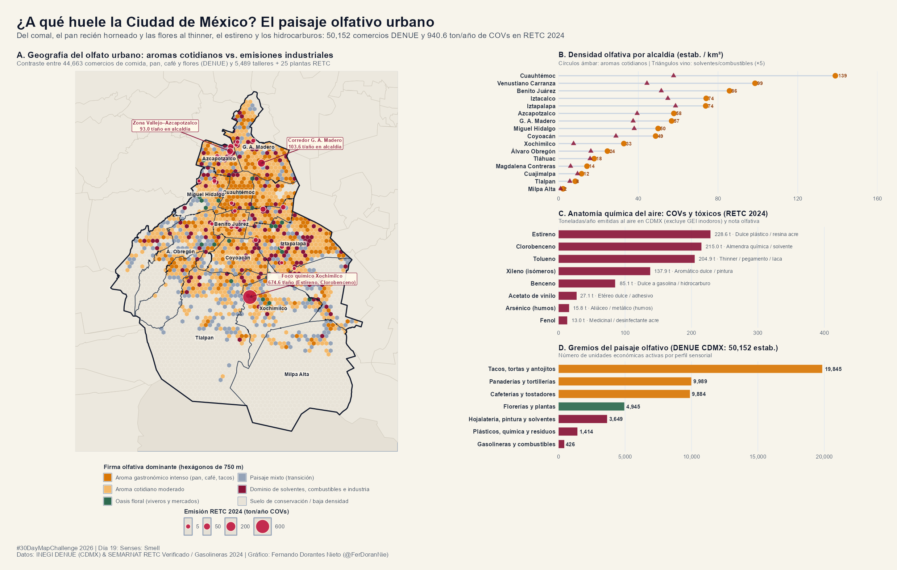

# Día 19 — Senses: Smell (19 de noviembre de 2026)

- **Título:** ¿A qué huele la Ciudad de México? El paisaje olfativo urbano
- **Eje temático:** 🇲🇽 México (Demografía, Sociedad y Medio Ambiente)
- **Estado:** ✅ **Completado y Publicado**
- **Herramientas:** Python (`pandas`, `openpyxl`) + R (`sf`, `data.table`, `ggplot2`, `patchwork`, `scales`, `ragg`)
- **Fuentes de datos (100 % oficiales):**
  1. **INEGI — Directorio Estadístico Nacional de Unidades Económicas (DENUE, Ciudad de México):** **50,152 establecimientos** con huella olfativa clasificados por código SCIAN:
     - *Aroma Cotidiano Gastronómico (39,718):* Tacos, tortas y antojitos (`722513`, `722514`: 19,845), panaderías y tortillerías (`311811`–`311830`: 9,989) y cafeterías y tostadores (`722515`, `311921`, `311922`: 9,884).
     - *Aroma Floral (4,945):* Florerías y plantas naturales (`466312`).
     - *Solventes, Combustibles e Industria Difusa (5,489):* Hojalatería, pintura y solventes (`811121`, `325510`, `467113`, `434226`: 3,649), plásticos, química y residuos (`3261*`, `434222`, `5621*`: 1,414) y gasolineras (`468411`: 426).
  2. **SEMARNAT — Registro de Emisiones y Transferencia de Contaminantes (RETC Verificado 2024 & Gasolineras 2024):** **25 establecimientos** en CDMX con emisiones al aire de Compuestos Orgánicos Volátiles (COVs) y sustancias químicas olorosas (**940.6 toneladas/año** excluyendo gases de efecto invernadero inodoros como CO₂, CH₄ y N₂O).
  3. **INEGI — Marco Geoestadístico Nacional:** Polígonos de alcaldías de CDMX (`09mun.shp`) y contexto del Estado de México (`15mun.shp`) proyectados en `EPSG:32614` (UTM Zona 14N).

---

## 🖼️ Póster Cartográfico



---

## 🎯 Metodología y Hallazgos

1. **Grilla Hexagonal (750 m entre centros) e Índice de Contraste Olfativo (`ICO`):**
   - Cada hexágono integra la densidad de comercios aromáticos cotidianos/florales frente a la carga ponderada de fuentes de solventes, hidrocarburos y emisiones industriales (`RETC 2024`), clasificando la ciudad en 6 firmas olfativas dominantes.
2. **Hallazgos Principales:**
   - **El corazón gastronómico:** **Cuauhtémoc** lidera la densidad olfativa cotidiana con **138.9 establecimientos/km²** (`4,513` comercios), seguida de **Venustiano Carranza** (`98.6/km²`) y **Benito Juárez** (`85.8/km²`).
   - **Oasis floral en Xochimilco vs. foco químico puntual:** Xochimilco concentra **24 hexágonos de oasis floral** (viveros y mercados de plantas), pero alberga también un foco industrial puntual en el RETC 2024 con **674.6 ton/año** de emisiones al aire (Estireno y Clorobenceno).
   - **Corredores industriales del norte y oriente:** **Gustavo A. Madero** (`103.6 ton/año`, 4 plantas RETC) y **Azcapotzalco** (`93.0 ton/año`, 5 plantas RETC en la zona de Vallejo) concentran la mayor densidad industrial de COVs, mientras **Iztapalapa** suma `1,327` talleres de solventes, pintura, plásticos y gasolineras.
   - **Anatomía química del aire:** Las mayores emisiones olorosas/volátiles al aire en CDMX corresponden a **Estireno** (`228.6 t`, dulce plástico), **Clorobenceno** (`215.0 t`, almendra química), **Tolueno** (`204.9 t`, thinner/laca), **Xileno** (`137.9 t`, pintura) y **Benceno** (`85.1 t`, gasolina dulce).

---

## 📂 Reproducibilidad

```powershell
# 1. Descarga de datos oficiales (RETC 2024 + DENUE CDMX)
C:\Users\fernando.dorantes\anaconda3\envs\data_engineering\python.exe days/day19_senses_smell/01_download_data.py

# 2. Extracción y limpieza tabular
C:\Users\fernando.dorantes\anaconda3\envs\data_engineering\python.exe days/day19_senses_smell/02_process_data.py

# 3. Procesamiento espacial y grilla hexagonal en R
& "C:\Program Files\R\R-4.3.2\bin\Rscript.exe" days/day19_senses_smell/03_process_spatial.R

# 4. Generación del póster editorial (300 dpi y 150 dpi)
& "C:\Program Files\R\R-4.3.2\bin\Rscript.exe" days/day19_senses_smell/04_plot_map.R

# 5. Generación del mapa interactivo HTML (Leaflet, autocontenido para GitHub Pages)
& "C:\Program Files\R\R-4.3.2\bin\Rscript.exe" days/day19_senses_smell/05_build_interactive.R
```

- **Salidas:**
  - `outputs/high_res/day19_senses_smell_paisaje_olfativo.png` (300 dpi)
  - `outputs/gallery/day19_senses_smell_paisaje_olfativo.png` (150 dpi)
  - `docs/day19/index.html` (mapa interactivo HTML con filtros por alcaldía y firma olfativa)
